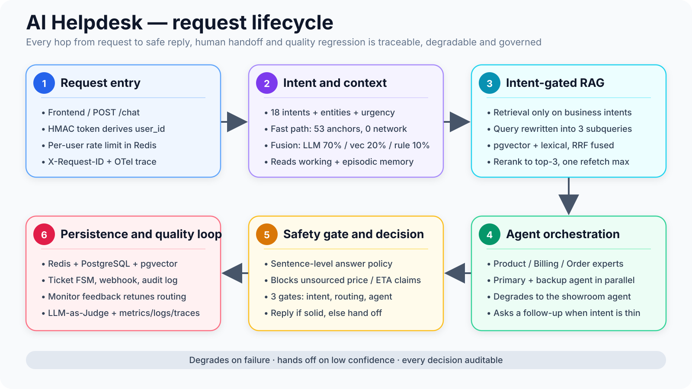
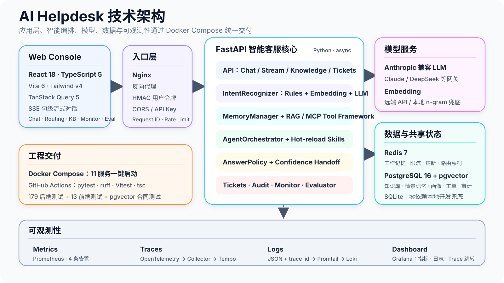

# AI Helpdesk

**English** · [简体中文](README.zh-CN.md)

A multi-agent customer support and ticket orchestration system. It classifies the
incoming question, retrieves supporting knowledge, routes to the right specialist
agent, and hands off to a human whenever the answer is not trustworthy enough.

FastAPI backend, React + TypeScript console. Tickets, knowledge base, monitoring,
tracing and regression evaluation are part of the system, not bolted on afterwards.

## What it is

One support request is split into seven independently governed stages — classify,
enrich with context, retrieve knowledge, collaborate across specialists, enforce
safety, escalate to a human, and regress on quality — each one observable and each
one able to degrade on its own.

- **Fine-grained intent recognition with a zero-latency path.** Requests are split
  into 18 intents, fused from three signals: LLM (70%), embeddings (20%) and rules
  (10%). The recognizer emits an intent, a confidence, per-source scores, an urgency
  level, and structured entities such as order numbers, amounts and part numbers.
  For 9 high-frequency deterministic classes, 53 high-precision anchor phrases
  short-circuit the whole thing: on a hit there is no network call at all, and the
  LLM round trips for one ticket drop from four to one.
- **Hybrid retrieval, gated by intent.** The knowledge base is only queried for
  business intents. Retrieval runs two ways in parallel — pgvector cosine similarity
  for semantic neighbours, and a tsvector keyword index for literal hits (Chinese is
  indexed as character bigrams, so no external tokenizer extension is required) —
  then fuses the two by rank with RRF. The lexical side covers exactly what dense
  vectors are systematically blind to: domain proper nouns and exact strings like
  order numbers. On the built-in corpus, hit@3 goes from 6/8 with vectors alone to
  8/8 (reproducible via `scripts/eval_retrieval.py`). Fusion happens in the storage
  layer and costs no LLM call, so the rule fast path benefits from it too and the
  zero-round-trip promise still holds. On top of that the full path rewrites the
  query into 3 parallel subqueries, deduplicates by content hash, and reranks to the
  top 3 — cross-encoder when configured, LLM otherwise. Without Postgres it falls
  back to SQLite with a pure-Python BM25 sparse side, which keeps local development
  dependency-free. Ingestion deduplicates by content hash, so re-uploading a
  document does not create a duplicate.
- **A retrieval loop with feedback.** Reranked passages are not handed straight to
  the agent. The system first decides whether the evidence actually answers the
  question; if it does not, it runs one more retrieval round aimed at the gap (hard
  cap of one — still insufficient, and the confidence gate escalates to a human).
  The sufficiency verdict comes back in the same call as the LLM rerank, so the
  extra LLM round trips are zero.
- **Multi-agent orchestration with a human backstop.** Three specialists — product
  and installation, quoting and billing, order fulfillment — plus a general showroom
  agent as fallback. Routing picks the primary agent from the intent, 40-odd keyword
  anchors and the extracted entities; cross-domain questions that clear the
  threshold get a supporting agent working in parallel. Unclear intent triggers a
  follow-up question, and any weak confidence signal opens a ticket and escalates.
- **Answer safety as a hard constraint, not a prompt.** Outbound answers pass
  through a zero-LLM rule guard, sentence by sentence. Price and turnaround
  commitments with no basis in the retrieved knowledge or the injected SOP are
  blocked and rewritten into something conservative, with the violation recorded in
  structured form. The streaming SSE path runs the same sentence-level check, so
  streaming and non-streaming answers cannot diverge on what they are allowed to say.
- **Multi-tenant safety and memory.** User identity is derived server-side from an
  HMAC-signed token, so a client cannot forge a `user_id` and read someone else's
  memory. Redis holds per-user rate limits and 24-hour working memory; pgvector
  holds episodic memory and user profiles; tickets and conversation audit logs are
  persisted and replayable.
- **A closed engineering loop.** Monitor adjusts the routing penalty every 10
  seconds from agent success rate and latency, shared across instances through
  Redis. LLM-as-Judge replays evaluations on four dimensions — relevance, accuracy,
  completeness, helpfulness — and detects regressions against a baseline that is
  only updated on an explicit promote. 461 backend tests, 46 frontend tests, an
  11-service Docker Compose environment, and metrics, logs and traces via
  Prometheus, Grafana, Tempo, Loki and OpenTelemetry.

## How one request flows



## Architecture



## Quick start

### Run the whole stack with Docker

With Docker and Docker Compose installed, from the project root:

```bash
cp .env.example .env
cp backend/.env.example backend/.env
# edit backend/.env and fill in ANTHROPIC_API_KEY
docker compose up -d --build
```

Once it is up:

| URL | What it is |
| --- | --- |
| http://localhost:5174 | Support console |
| http://localhost:8080/docs | API docs |
| http://localhost:3000 | Grafana — metrics, logs and traces |
| http://localhost:9090 | Prometheus metrics |

### Local development

Create `backend/.env` from `backend/.env.example`, fill it in, then:

```bash
./dev.sh
```

That starts the backend and the frontend together. Open http://localhost:5173.

## Where things live

| Task | Entry point |
| --- | --- |
| Talk to support | The console, or `POST /chat` |
| Streaming conversation | `POST /chat/stream` |
| Inspect the knowledge base | The console, or `GET /knowledge/stats` |
| Ingest knowledge | `POST /knowledge/add`, `POST /knowledge/upload` |
| List human tickets | `GET /tickets` |
| Service health | `GET /health`, `GET /monitor` |
| Run an evaluation | `POST /eval/run` |

Full API reference is at http://localhost:8080/docs once the service is running.

## Layout

```text
backend/         FastAPI service, agent orchestration, KB, memory, tickets, monitoring
frontend/        React admin console
backend/skills/  Per-agent SOPs, hot-reloadable
```

Redis holds short-lived state — rate limits, recent conversation. PostgreSQL +
pgvector holds the knowledge base, tickets, audit records and long-term memory.
Without Postgres configured the backend falls back to SQLite, which is enough to
try the system locally.

## Tests

```bash
cd backend && pytest && ruff check .
cd frontend && npm test && npm run typecheck
```

Currently **461 passed / 2 skipped** on the backend and **46 passed** on the
frontend. CI runs in 3 stages; one of them brings up a pgvector service container
so the Postgres path is exercised for real rather than falling back to SQLite.

## Performance

`backend/scripts/load_test.py` writes a JSON report with p50 / p95 / RPS.

```bash
cd backend && ./.venv/bin/python scripts/load_test.py --unique-messages --requests 100 --concurrency 10
```

**`--unique-messages` is not optional.** The message pool only holds 10 entries;
without the flag the script cycles through them, and from request 11 onward the
in-process intent cache in `core/intent_recognizer.py` hits every time. Those
requests skip the intent LLM call entirely and p95 comes out roughly 11% below a
genuine first-time ticket. The script warns when the flag is missing and records a
`mode` field in the report.

These are single-instance cold-path numbers. No capacity planning has been done and
nothing here has been validated against real production traffic — this is
engineering built to production standards, not a production-proven system.

## Stack

FastAPI · React · TypeScript · PostgreSQL + pgvector · Redis · Anthropic-compatible
API · OpenTelemetry · Prometheus · Grafana · Docker Compose
