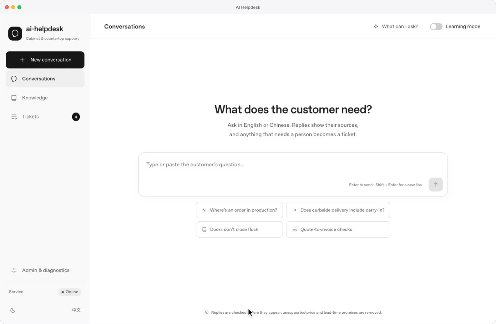
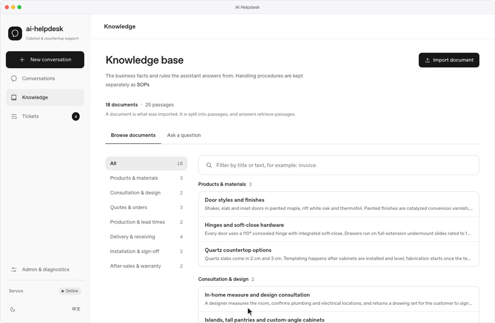

<div align="center">

# AI Helpdesk

**Support answers grounded in your knowledge base and live order data, with a ticket when a person should step in.**

A multi-agent support service: FastAPI routes each question to specialist agents, retrieves from a hybrid pgvector and keyword index, checks every sentence for unsupported price and lead-time promises before it streams, and opens a ticket when confidence is low. A React console covers chat, the knowledge base, tickets and model settings.

[](backend/Dockerfile)
[](backend/requirements.txt)
[](frontend/package.json)
[](docker-compose.yml)
[](https://github.com/heyemlee/ai-helpdesk/actions/workflows/ci.yml)

**English** · [简体中文](README.zh-CN.md)

[Highlights](#highlights) · [Architecture](#architecture) · [Tech stack](#tech-stack) · [Features](#features) · [Develop](#develop)

</div>

<p align="center">
  
</p>

<p align="center"><sub>A made-up cabinet company, with its orders, tickets and knowledge base served by a mocked API.</sub></p>

## Highlights

- **Hybrid retrieval, measured.** pgvector cosine and a PostgreSQL `tsvector` index (BM25 on the SQLite fallback), fused by reciprocal rank fusion. On 108 questions over a 56-passage knowledge base, the right document is in the top three for 101 with Qwen3-Embedding-0.6B, against 77 with local vectors.
- **A cheap path for routine questions.** 19 intents decided by a weighted vote of an LLM, embeddings and rules (0.7 / 0.2 / 0.1); a rule anchor skips the intent model, query rewriting and reranking. Three specialist agents compete for each question, with a generalist fallback.
- **Checked before it streams.** Answers stream over SSE one sentence at a time. A rule-based guard holds back any price or lead-time promise whose number and unit don't appear together in the retrieved passages, the SOP or verified order data.
- **Fails closed when the model is down.** A rejected key (401, 402 or an explicit 403) stops calls for that configuration; a 429 backs off for at most 900 s. An outage reply opens no ticket, and an evaluation run stops without writing its baseline.
- **Tested against real services in CI.** 953 backend tests with pgvector in a service container, 216 frontend tests, consumer tests against the cross-repo A2A contract pinned at `v1.12`, and both Docker images built on every push.

## Architecture

<p align="center">
  
</p>

A question reaches the staff instance from the console, or the customer instance through Nginx on port 80. The service reads working memory from Redis, votes on the intent, retrieves passages from PostgreSQL and runs the specialist agents against the chat model. On the staff instance, order questions go to [ai-sql-agent](https://github.com/heyemlee/ai-sql-agent) over A2A. The reply streams back sentence by sentence, or a ticket is opened and its webhook queued in an outbox.

- **Two entrances, one image.** The customer instance never asks the SQL agent and keeps no memory across sessions: its user IDs come from the request body, so a guessed staff ID would otherwise pull a staff member's history into a customer's context. Only Nginx on port 80 accepts connections from other machines.
- **A handoff is a decision; an outage is not.** Low confidence (intent < 0.45, routing < 0.35, agent < 0.70) or an explicit request opens a ticket. When the model is unavailable, the reply says the question was not answered and opens nothing, so a revoked key can't flood the ticket queue.

## Tech stack

| Layer       | Technology                                                                   | Role                                                                                      |
| ----------- | ---------------------------------------------------------------------------- | ----------------------------------------------------------------------------------------- |
| API         | Python 3.12 · FastAPI · Pydantic 2 · Uvicorn                                 | Chat and SSE streaming, knowledge, tickets, evaluation and model-connection endpoints     |
| Agents      | asyncio orchestration · Anthropic SDK · OpenAI SDK                           | Intent vote, specialist routing and fallback, query rewriting, reranking, LLM-as-judge    |
| Retrieval   | PostgreSQL 16 · pgvector · `tsvector` · BM25 · RRF                           | Hybrid search over knowledge passages; SQLite with BM25 as a local fallback               |
| State       | Redis 7 · asyncpg                                                            | Working memory, rate limits and shared circuit-breaker state; memory, tickets and audit   |
| Console     | React 18 · TypeScript · Vite 6 · TanStack Query 5 · Tailwind CSS 4           | Chat, knowledge base, tickets, admin and diagnostics, in English and Chinese              |
| Integration | A2A over HTTP · HMAC user tokens · webhooks                                  | Order lookups in ai-sql-agent, signed user identities, ticket notifications via an outbox |
| Operations  | Docker Compose · Nginx · OpenTelemetry · Prometheus · Grafana · Tempo · Loki | 12 services in one deploy, with traces, metrics, logs and alert rules                     |
| Quality     | pytest · Ruff · Vitest · Testing Library · GitHub Actions                    | Backend, frontend, contract and image checks on every push                                |

## Features

### Retrieval

Every answer is built from passages retrieved for it, and the console lists them under the reply.

- **Two legs, fused by rank.** Dense (pgvector cosine) and lexical (`ts_rank_cd`, or BM25 over Chinese character bigrams on SQLite), ten candidates each, fused by rank rather than by incompatible scores. With only local n-gram vectors, keyword matches come first and vectors fill the rest.
- **One corrective round.** Complex questions are rewritten into three sub-queries and reranked; when the evidence is judged insufficient, one more round searches for what is missing.
- **Model switches without downtime.** Changing the embedding model re-embeds every stored vector while the service keeps answering, then cuts over. The service refuses to start on vectors another model produced.

Top-three hits on PostgreSQL, by question type:

| Question type                  |   Cases | Local n-gram vectors | Qwen3-Embedding-0.6B |
| ------------------------------ | ------: | -------------------: | -------------------: |
| Wording close to the document  |      35 |                   31 |                   33 |
| Colloquial paraphrase          |      30 |                   22 |                   28 |
| Model codes and proper names   |      11 |                   11 |                   11 |
| English over Chinese documents |      22 |                    7 |                   21 |
| Two documents needed           |       6 |                    3 |                    4 |
| Current vs. superseded version |       4 |                    3 |                    4 |
| **All**                        | **108** |               **77** |              **101** |

The 52 documents and 122 questions (14 with no answer in the corpus) are simulated and were written for testing. Even with the remote model, a superseded document ranks ahead of the current one in 4 of 6 cases. Conditions and reproduction: [local vectors](docs/evaluation/retrieval-ca-factory.md), [remote embedding](docs/evaluation/retrieval-remote-embedding.md).

### Routing, answer guard and handoff

- **Intent and routing.** Conflicting rule anchors give up and fall back to the full vote. Product & Install, Quotes & Billing and Order Fulfilment compete on domain scores; a second specialist joins in parallel when a question spans domains, and monitor penalties steer traffic away from a degraded instance.
- **Answer guard.** A sentence is removed only when it has an amount or a time, a commitment verb, no hedge and no source. The customer never sees it; staff see what was removed and why.
- **Handoff.** Tickets move through open, assigned, resolved and cancelled. Each notification is written to an outbox before delivery, with retries and the HTTP status recorded, and the console shows whether it arrived.

### Knowledge base, tickets and admin

<p align="center">
  
</p>

<p align="center"><sub>The same made-up company and mocked API.</sub></p>

**Knowledge base** keeps the documents the assistant answers from.

- Seven fixed categories for browsing; moving a document between them leaves retrieval untouched.
- **Ask a question** runs the same retrieval as the chat path and shows the passages, scores and legs it would return.
- Import `.txt`, `.md` or JSON document lists; re-importing identical text changes nothing.

**Tickets** are where people pick up what the assistant handed off.

- Filter by status; each ticket offers only the transitions the backend's state machine allows.
- The detail shows why it was handed off, the full conversation and the notification's delivery record.
- A handoff in chat links straight to its ticket, and the card updates when the ticket moves.

**Admin & diagnostics** is for supervisors and developers.

- Model connections are tested before they are saved: a plain reply and a structured-output call for the chat model, one request for the embedding model. Keys are write-only; the page shows only the last four characters.
- An LLM-as-judge evaluation scores 16 dialog turns on relevance, accuracy, completeness and helpfulness, plus intent accuracy on 90 labelled messages; the baseline changes only on an explicit promote.
- Monitoring, SOPs and an orchestration inspector that shows the routing scores and policy findings of any reply.

## Develop

```bash
cp .env.example .env                  # Compose variables: database, Redis and Grafana passwords
cp backend/.env.example backend/.env  # set APP_ENV=development and a model provider key
docker compose up -d --build          # the full stack; console at http://localhost:5174
scripts/dev.sh                        # or backend and console from source, at http://localhost:5173
scripts/dev-all.sh                    # the same, plus ai-sql-agent from a sibling checkout
```

Configuration, model providers, importing knowledge, local setup without Docker and the API are in [docs/setup.md](docs/setup.md).

## Test

```bash
scripts/ci-local.sh                         # the CI checks; --with-images adds both image builds
cd backend && .venv/bin/python -m pytest    # backend tests; TEST_POSTGRES_DSN adds the pgvector ones
.venv/bin/python scripts/eval_retrieval.py  # retrieval hit@3 and MRR, no model calls
cd ../frontend && npm test                  # console tests
```

CI runs Ruff and the backend tests against pgvector, the console tests and production build, the A2A contract fixtures and both Docker images. The LLM-as-judge evaluation calls the model, so it runs only on request (`POST /eval/run`).

## Deploy

```bash
docker compose up -d --build                    # 12 services; only Nginx :80 listens beyond localhost
scripts/docker-deploy.sh backup                 # Postgres, Redis, env files and deploy/ config
scripts/docker-deploy.sh restore backups/<dir>  # restore and restart; a drill took 17 s
```

In production mode the service refuses to start without the admin key, the user-signing secret, chat protection and a declared deployment scope. It is single-tenant by design; [deployment boundaries](docs/deployment-boundaries.md) explains what that covers.
