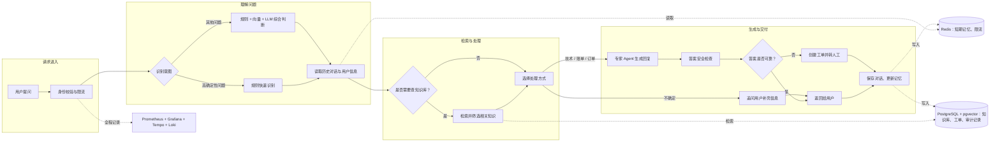

# AI Helpdesk

一个面向企业场景的智能客服系统。它能识别用户问题、检索知识库、分配给合适的客服 Agent，并在答案不够可靠时自动转人工。

后端使用 FastAPI，前端是 React + TypeScript 控制台；内置工单、知识库、监控、追踪和回归评测能力。

## 项目介绍

这是一个面向生产环境设计的多 Agent 智能客服与工单编排系统。它把一条客服请求拆成“识别问题、补充上下文、检索知识、专家协作、安全校验、人工接手、质量回归”七个可独立治理的环节，并提供可视化控制台与完整的可观测性能力。

- **高可靠意图识别与低延迟路径**：将客服请求细分为 18 类意图，融合 LLM（70%）、向量（20%）和规则（10%）三路信号，输出意图、置信度、来源分数、紧急度及订单号、金额、错误码等结构化实体。针对 9 类高频确定性问题，内置 52 个高精度锚点短语；命中后无需网络调用，并将单次工单的 LLM 往返从 4 次降至 1 次。
- **按需触发的 RAG 知识库**：仅在业务类意图下检索知识库。系统基于 PostgreSQL + pgvector 的余弦相似度搜索，对查询改写为 3 个子查询并行召回、按内容去重，再由 LLM 重排得到最相关的 3 条资料；未配置 Postgres 时可回退 SQLite，便于零依赖本地开发。知识导入使用内容哈希去重，重复上传不会生成重复文档。
- **多 Agent 编排与人工兜底**：编排技术、账单、订单物流 3 个专家 Agent 和 1 个通用兜底 Agent。路由会综合意图、40 余个关键词锚点和实体信息选择主 Agent；跨领域问题满足阈值时由辅助 Agent 并行参与。意图不清先追问，任一置信度信号偏低则创建工单转人工。
- **把回答安全做成硬约束**：出站答案经过零 LLM 的规则守卫逐句检查。对没有知识库或 SOP 依据的价格、时效承诺进行拦截并改写为保守表述，同时记录结构化违规信息；流式 SSE 输出也使用同一套句级校验，避免流式与非流式结果标准不一致。
- **面向多租户的安全与记忆**：通过 HMAC 签名令牌在服务端推导用户身份，避免客户端伪造 `user_id` 读取他人记忆；Redis 提供按用户限流和 24 小时工作记忆，pgvector 保存情景记忆与用户画像，工单和对话审计日志可持久化回查。
- **完整工程化闭环**：Monitor 每 10 秒根据 Agent 成功率和延迟调整路由惩罚，并通过 Redis 在多实例间共享；LLM-as-Judge 从相关性、准确性、完整性、帮助性四个维度回放评测，并基于人工提升的基线识别回归。项目包含 179 个后端测试、13 个前端测试、11 服务 Docker Compose 环境，以及 Prometheus、Grafana、Tempo、Loki 和 OpenTelemetry 组成的指标、日志、链路追踪体系。

## 一次请求如何流转



简单来说：系统先判断用户要解决什么，再决定是否查资料、交给哪个专家回答；如果回答风险高或信心不足，就交给人工，而不是编造答案。

## 快速开始

### 用 Docker 运行完整系统

准备 Docker 和 Docker Compose，然后在项目根目录执行：

```bash
cp .env.example .env
cp backend/.env.example backend/.env
# 编辑 backend/.env，填入 ANTHROPIC_API_KEY
docker compose up -d --build
```

启动后可访问：

| 地址 | 用途 |
| --- | --- |
| http://localhost:5174 | 客服控制台 |
| http://localhost:8000/docs | API 文档 |
| http://localhost:3000 | Grafana 监控、日志与链路追踪 |
| http://localhost:9090 | Prometheus 指标 |

### 本地开发

先按 `backend/.env.example` 创建并填写 `backend/.env`，再执行：

```bash
./dev.sh
```

这会同时启动后端和前端。浏览器打开 http://localhost:5173 即可。

## 常用能力入口

| 需求 | 入口 |
| --- | --- |
| 与客服对话 | 控制台，或 `POST /chat` |
| 流式对话 | `POST /chat/stream` |
| 查看知识库 | 控制台，或 `GET /knowledge/stats` |
| 导入知识 | `POST /knowledge/add`、`POST /knowledge/upload` |
| 查看人工工单 | `GET /tickets` |
| 查看服务状态 | `GET /health`、`GET /monitor` |
| 运行评测 | `POST /eval/run` |

完整接口说明可在启动后打开 http://localhost:8000/docs 查看。

## 核心组件

```text
backend/         FastAPI 服务、Agent 编排、知识库、记忆、工单与监控
frontend/        React 管理控制台
backend/skills/  不同客服 Agent 使用的服务规范（SOP）
```

系统使用 Redis 保存短期状态，如限流和近期对话；使用 PostgreSQL + pgvector 保存知识库、工单、审计记录和长期记忆。没有配置 Postgres 时，后端可退回 SQLite，方便本地体验。

## 测试

```bash
cd backend && pytest && ruff check .
cd frontend && npm test && npm run typecheck
```

## 技术栈

FastAPI · React · TypeScript · PostgreSQL + pgvector · Redis · Anthropic 兼容 API · OpenTelemetry · Prometheus · Grafana · Docker Compose
