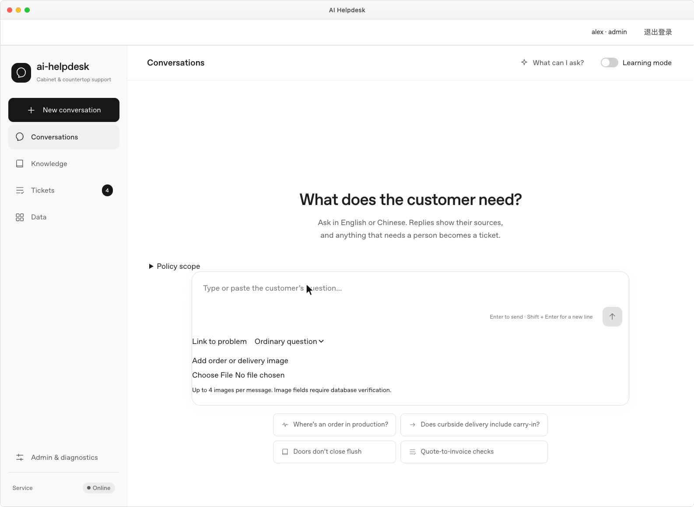
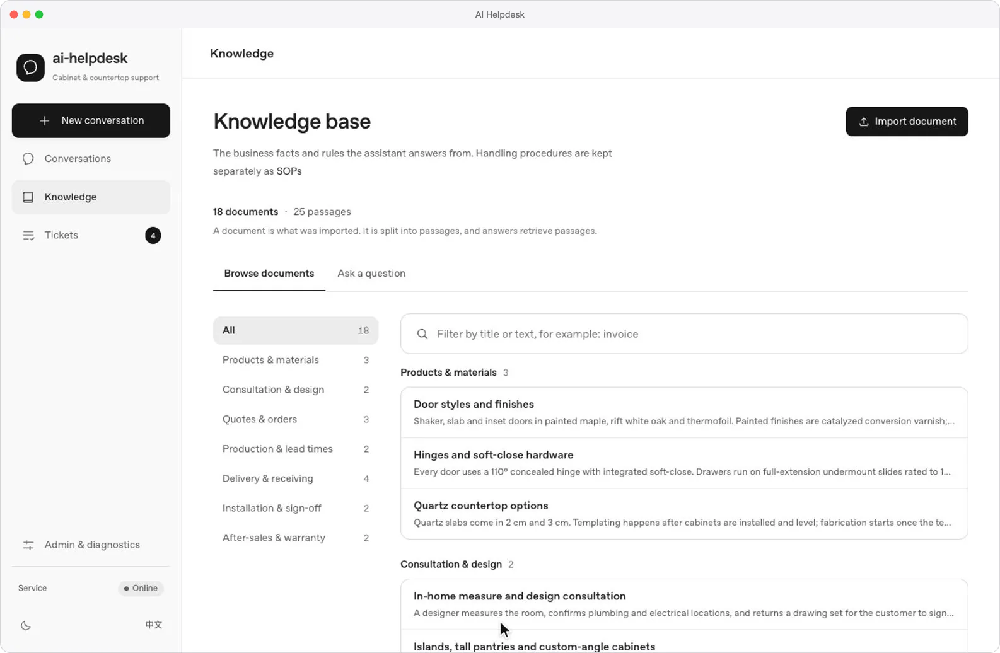

<div align="center">

# AI Helpdesk

**两个协作的 Agent 服务和它们之间的契约：多 Agent 客服服务、它通过 A2A 委派的 Text2SQL Agent，以及一份带版本、由机器校验的 A2A 契约，都在一个仓库里。**

客服 Agent 对每个问题的意图投票，工具并发执行，专家 Agent 作答（问题跨领域时并行），缺资料时在有边界的工具循环里补查，每句话发出之前都要过检查。SQL Agent 在权限闸门后面自己规划、执行、修复只读 SQL，并把每个阶段实时传回。配套的 React 工作台实时展示每一步 Agent 决策。

[](backend/Dockerfile)
[](backend/requirements.txt)
[](frontend/package.json)
[](docker-compose.yml)
[](a2a-contract/README.zh-CN.md)
[](https://github.com/heyemlee/ai-helpdesk/actions/workflows/ci.yml)

[English](README.md) · **简体中文**

[技术亮点](#技术亮点) · [系统架构](#系统架构) · [技术栈](#技术栈) · [功能](#功能) · [本地开发](#本地开发) · [AI 辅助开发](#ai-辅助开发)

</div>

<p align="center">
  
</p>

<p align="center"><sub>虚构的公司、订单和文档，由模拟的 API 提供。</sub></p>

## 技术亮点

- **路由与专家 Agent。** LLM、Embedding 和规则按 0.7 / 0.2 / 0.1 对 19 个意图投票，用 gpt-6-luna 时 90 条标注消息对了 77 条。再按领域分数从三个专家里选出主处理，每个专家跑多个副本，由监控按成功率和延迟调整权重；第二个专家分数不低于 0.45、且不低于第一名的 55% 时并行加入。
- **有边界的工具循环，A/B 过了才打开。** 预取的资料不够时，专家通过 function calling 自己再调同样的检索和查数，每轮最多 3 次模型调用、1 次委派。72 组成对 A/B 里，规则漏掉数据的问题有 26/30 轮拿到了数据（规则组一轮都没有），没有越权调用，也没有编造数字，所以员工实例上打开了。
- **自带循环的 Text2SQL Agent。** 数据类问题交给 `ai-sql-agent/` 下的 SQL Agent，它是独立的服务：先路由，再按数据源一步一步规划、写 SQL，由 SQLGlot 闸门对照调用方的表和列权限检查后只读执行，出错最多自修两次，返回前还要检查结果。最近三轮发布门禁：跨库准确率 94.7%，没有提示的错答占 0.9%。
- **一份契约下的 Agent 间委派。** 走 A2A 时 SQL Agent 把每个阶段实时传回，另有 Agent Card 发现、降级和超时。`a2a-contract/` 里的契约（5 个 JSON Schema、30 个 golden fixture）由两个 Agent 在同一个提交上测试，改协议和两侧的实现在同一个 PR 里合进来。
- **Agent 之间默认不信任。** 委派结果只有在执行状态为 success 或 partial_success、且没有风险或降级标记时才算证据；字段缺失一律按不可信处理。价格和日期只能以证据、检索到的片段和 SOP 为依据。
- **带自纠错回路的检索。** 改写成三个子查询，同时查 pgvector 和关键词索引，用 cross-encoder 或 LLM 重排并判断依据够不够，不够就针对缺的部分再检索一轮。单看融合检索这一步，108 道测试题里有 101 道把正确文档排进前 3。
- **护栏与人工接管。** 每句话发出之前都要过检查，没有依据的价格或日期承诺会被替换。专家会声明是否需要人工，置信度低时建工单；模型停机时暂停调用，而不是建工单。
- **一轮对话不跟着 worker 一起死。** 排队模式下一轮对话是 Postgres 里的一个 run，由拿着带栅栏租约的 worker 执行，回答在任何副作用之前先记下；工单、审计和记忆都按 run 去重，客户端断线后带 `Last-Event-ID` 续读。五次故障演练里，340 个 run 经历了杀 worker、重启和清空 Redis，没有多出一张工单、一条审计或一个回答；同样的断线和 API 重启，旧的 inline 模式丢了 53% 的对话，排队模式一轮没丢。
- **事件日志可以走 Kafka。** 每一轮的事件发进 Kafka，投影和评测采样两个消费者各记各的 offset；投影能从 topic 重建，删除请求在回放时照样作数；把两个消费者都杀掉、重启 broker 的演练，Kafka 里的每一条事件都在 Postgres 里对上了。单个投影消费者每秒写库约 2.1 万条事件，走 Kafka 比直接写库每条多约 24 毫秒。

## 系统架构

<p align="center">
  
</p>

两个服务，一份契约。员工工作台和经 80 端口 Nginx 进来的客户访问客服 Agent；它的员工实例把数据类问题委派给 SQL Agent，走 A2A（`message/stream`，阶段事件经 SSE 传回）或默认的 HTTP `/query`。两者保持为两个服务：业务库的访问权和执行模型写的 SQL 只在 SQL Agent 里，两边各自钉自己的 Python 和框架版本，一个重查询也拖不垮对话服务。它们之间的契约是同一个仓库里的一个目录，两侧测试读同一个提交上的它。

| 目录 | 是什么 | 技术 | 文档 |
| --- | --- | --- | --- |
| `backend/` · `frontend/` | 客服 Agent 和它的员工工作台 | Python 3.12 · FastAPI · React 18 | 本页 · [setup](docs/setup.md) |
| `ai-sql-agent/` | Text2SQL Agent，提供 A2A、MCP、HTTP 接口，自带控制台 | Python 3.11 · FastAPI · SQLGlot | [README](ai-sql-agent/README.zh-CN.md) |
| `a2a-contract/` | A2A 契约：协议文档、JSON Schema、golden fixture、自检脚本 | JSON Schema 2020-12 · Python | [README](a2a-contract/README.zh-CN.md) |
| `deploy/` · `scripts/` | Compose、Kubernetes 和监控配置；本机 CI、开发和部署脚本 | Docker Compose · Kubernetes · KEDA | [setup](docs/setup.md) |

### 客服 Agent 内部

<p align="center">
  
</p>

问题从工作台进员工实例，或者经 80 端口的 Nginx 进客户实例，然后依次经过五个阶段。**理解**（Understand）读取记忆并投票定意图；**收集**（Gather）同时运行规则为它选中的工具：在 PostgreSQL 里做混合检索，在员工实例上还会通过 A2A 或 HTTP `/query` 委派 [SQL Agent](ai-sql-agent/README.zh-CN.md) 查数据；**路由**（Route）给专家打分并选出副本，**作答**（Answer）由专家结合各自的 SOP 完成，员工实例上还能自己补查缺的资料，**检查**（Check）在发出前逐句把关，需要人工时建工单，通知先写进 outbox 再投递到 webhook。排队模式下，同样的五个阶段改在 worker 上跑，worker 对这个 run 持有带栅栏的租约：它挂了，另一个 worker 以第 2 次尝试接手，工作台用 `Last-Event-ID` 接着读流；事件日志也可以改走 Kafka（见[可恢复的运行](#可恢复的运行)）。

- **规则先查，专家补缺。** 查不查知识库、查不查数据，在任何 Agent 运行之前就由投票得出的意图和实体决定，两路查询同时进行。打开工具循环后，专家读完资料还缺东西时，会在预算内自己再调同样的工具；关着时每一轮的模型调用次数可预期。开放式的循环（规划 SQL、出错自修）放在 SQL Agent 里，由带版本的契约约束。
- **两个入口，同一个镜像。** 客户实例从不委派、不开工具循环，也不保留跨会话记忆，因为它的用户 ID 取自请求体；只有 80 端口的 Nginx 接受其他机器的连接。

## 技术栈

| 层             | 技术                                                                   | 作用                                                                                                                                                            |
| -------------- | ---------------------------------------------------------------------- | --------------------------------------------------------------------------------------------------------------------------------------------------------------- |
| Agent 运行时   | Python 3.12 · FastAPI · asyncio                                        | FastAPI 用 SSE 提供对话；asyncio 用 `gather` 并发执行预取、并行专家和工具循环每一步的调用，把阻塞的存储调用移出事件循环，并把进度推进流里                       |
| 模型调用       | Anthropic SDK · OpenAI SDK · Pydantic 2                                | 两家供应商共用一套接口，可在线切换，function calling 两边互译；每个模型决策（意图投票、查询改写、重排结论、用户画像、评审打分）都是 Pydantic 结构，用之前先校验 |
| Agent 协议     | A2A JSON-RPC（`message/stream`、`message/send`）· Agent Card · httpx   | 委派给 SQL Agent，带实时阶段、降级和超时；默认传输是普通 HTTP `/query`                                                                                          |
| Text2SQL Agent | Python 3.11 · FastAPI · SQLGlot · psycopg 3 · MCP                      | 独立的服务：JSON Schema 结构化输出的路由、YAML 语义层上的 BM25 加向量检索、逐表逐列的 AST 闸门、在 SQLite 或 PostgreSQL 上只读执行，提供 A2A、MCP、HTTP 接口（[详情](ai-sql-agent/README.zh-CN.md#技术栈)） |
| Agent 契约     | JSON Schema 2020-12 · golden fixture · Python 自检                     | 5 个 schema 和 30 个 fixture，两个 Agent 的测试都读；自检确认每个反例真的被拒、每一处版本号都一致 |
| 向量与重排     | OpenAI 兼容 `/embeddings` · 本地 n-gram 向量 · cross-encoder `/rerank` | 知识库、情景记忆和意图投票共用一个向量化入口，没配 API 时用本地向量；重排优先 cross-encoder，LLM 兜底                                                           |
| 检索存储       | PostgreSQL 16 · pgvector · `tsvector` · asyncpg · SQLite               | 稠密和关键词两路按名次融合；本地兜底用 SQLite 加 BM25                                                                                                           |
| 记忆与共享状态 | Redis 7                                                                | 24 小时工作记忆及其压缩锁、按用户限流，以及多实例共享的熔断状态和路由扣分；排队模式下还有 run 的派发和可续读的帧流（Streams）、模型调用的令牌桶（Lua）     |
| 事件流         | Apache Kafka 4.3（KRaft）· aiokafka                                    | 事件日志的可选去处：每个实例一个 topic、按会话分区，投影和评测采样是两个消费组，坏消息进死信 topic，留 7 天可回放 |
| 护栏与身份     | 纯规则的答案策略 · 置信度门槛 · HMAC 用户令牌                          | 逐句检查、转人工判定、签名的用户身份                                                                                                                            |
| 工作台         | React 18 · TypeScript · Vite 6 · TanStack Query 5 · Tailwind CSS 4     | 从 `fetch` 流里读 SSE（EventSource 不支持 POST）、流式 Markdown 和学习模式，中英文界面                                                                          |
| 可观测性       | OpenTelemetry · Prometheus · Grafana · Tempo · Loki                    | 每个请求的链路追踪、指标、日志和告警规则，另有监控的 Z-score 异常检测                                                                                           |
| 交付与质量     | Docker Compose · Nginx · Kubernetes · KEDA · GitHub Actions · pytest · unittest · Ruff · Vitest · k6 | 一次部署 13 个服务，或者用 Kustomize 清单、worker 由 KEDA 扩缩；一套 CI 连 pgvector 跑两个 Agent 的测试（客服的还连 Redis 和 Kafka），并跑契约自检和三个镜像的构建；排队模式另有 k6 压测和故障演练 |

## 功能

### Agent 编排

一轮流式回答依次收到 `progress → meta → routing → delta → result`；工作台实时显示每个阶段，学习模式逐条讲解每个决策。

- **路由。** 命中规则锚点时不调模型就定下意图，并跳过改写和重排；锚点互相冲突时交给完整投票，问题不清楚时先追问。
- **副本与反馈。** 每类专家默认跑两个副本。监控跟踪成功率和延迟，做 Z-score 异常检测；成功率低于 90% 或变慢时给副本扣分，最多 0.9，把后面的请求引到更健康的副本。
- **协作与兜底。** 单个专家的回答逐句流出；并行专家的回答合并在一起，各自标明主处理还是辅助处理。专家失败时由通用 Agent 接手，流式输出到一半时例外，这一轮如实报告没有答完。
- **工具循环。** 设 `AI_HELPDESK_TOOL_LOOP=on` 后（这里的员工实例就是这样），专家可以通过 function calling 自己调 `knowledge_search` 和 `order_data_query`：每个专家每轮最多 3 次模型调用、1 次委派，身份由服务端注入，报价不许查库，和预取相同的查询直接复用，墙钟上限按最慢的工具推算，一次委派超时之后不再委派。失败作为工具结果交还模型；每次调用都作为进度流出，学习模式逐条列出结局和耗时。
- **一轮的事件日志。** 设 `AI_HELPDESK_EVENT_LOG=full` 后，每一轮按顺序记成事件追加进 Postgres：意图、预取、路由、按用途分的每次模型调用和 token、每次工具调用、守卫替换、转人工和最终回答。写入在回答路径之外批量进行，原文比结构先到期清掉，两个实例的记录互不可见。刷新之后工作台靠它恢复那一轮的检查器和学习模式，离线脚本拿真实流量重放路由和答案守卫。
- **专家自己声明转人工。** 每个专家在回答末尾加一个标记，说明是否需要人工，这个标记会从流里摘掉；声明需要人工时，它的置信度会降到 0.70 的门槛以下。
- **记忆与技能。** 工作记忆在 Redis 里保留 24 小时，攒到 15 条时压缩成摘要；以前会话的摘要和用户画像也会带回上下文。每个专家从各自的 `SKILL.md` 加载 SOP，不用重启就能重新加载。

| 用 gpt-6-luna 跑一次      | 结果                                                       |
| ------------------------- | ---------------------------------------------------------- |
| 90 条标注消息上的意图投票 | 对 77 条（85.6%），macro-F1 0.798                          |
| LLM 评审的对话轮次        | 完成的 15 轮里通过 14 轮；16 轮中有 1 轮被上游连接错误打断 |

评审模型就是被测模型，用例都是中文（[评测记录](docs/evaluation/end-to-end.md)）。自带的意图、专家、SOP 和知识是一个制造商的客服场景；换到别的领域，要在代码里改意图和专家。

| 工具循环 A/B，gpt-6-luna，72 组成对       | 规则组 | 循环组 |
| ----------------------------------------- | -----: | -----: |
| 规则漏掉的数据到了专家手里（B 类 30 轮）  |      0 |     26 |
| 规则已经够用时的多余调用（A、D 类 18 轮） |      — |      1 |
| 编造数字或照做注入（E、F 类）             |      0 |      0 |
| 转人工（72 轮）                           |     46 |     39 |
| 每轮输入 token 均值                       |  2,692 |  4,915 |
| LLM 评审分（A–C 类）                      |  0.899 |  0.896 |

这是两轮里的第二轮：第一轮有两道打开门槛没过，中间改了什么见[评测记录](docs/evaluation/tool-loop-ab.md)（英文）。订单数据来自契约夹具，所以延迟里没有真实委派的 17–40 秒。

### Agent 间委派

员工实例上的数据类问题交给 [ai-sql-agent/](ai-sql-agent/README.zh-CN.md) 下的 SQL Agent，它用自己的发布门禁衡量准确率。`SQL_AGENT_TRANSPORT=a2a` 时通过 `message/stream` 实时传回各个阶段；默认值 `query` 调用它的同步 HTTP `/query`。

- **流式加降级。** Agent Card 缓存 30 秒；每个阶段（找表、规划、写 SQL、查询、自修）按界面语言显示在工作台上。流打开之前收到 `-32004` 就改用 `message/send`；静默超时或超过总时长就结束调用。
- **每种传输都用同一套证据规则。** A2A 和 `/query` 的结果过同一道检查；部分成功时失败的那几步不能下结论，结果被截断时不能报总数。
- **一份契约，同一个提交。** 两个 Agent 的测试读同一个提交上 [a2a-contract/](a2a-contract/README.zh-CN.md) 的 golden fixtures；拿不到 fixture 时测试失败，而不是跳过。两侧各自声明实现的契约版本 `v1.13`，任何一边和契约对不上，CI 就失败。

### Text2SQL Agent

SQL Agent 是独立的服务，有自己的发布门禁和部署方式（[README](ai-sql-agent/README.zh-CN.md)）；它的页面是同一个控制台里的「数据」，经 `/sql-api/` 调它，Key 由控制台在服务端带上。

- **先路由，再规划。** 模型路由用 JSON Schema 结构化输出，在工具和记忆之间做选择；规划器把其余问题拆成若干步，前一步的结果交给下一步。
- **只有一个工具，守在一道闸门后面。** 它只能执行只读 SQL。SQLGlot 的 AST 闸门对照调用方的权限检查每一张表、每一列，解析不了的一律拒绝；每次调用限 1,000 行、10 秒、8 MiB。
- **自己修，自己查。** 调用失败时按日志修复，最多两次；结果先过规则检查和模型自检，再返回。
- **上下文自己保持最新。** 按库、表、列三级检索，用 RRF 融合 BM25 和向量结果后再重排；库结构变了，监听器会重建索引。用远程 Embedding 时，40 条留出问法召回 99.2%，只送出 36.8% 的表结构。
- **每次运行都能跟踪、能取消。** A2A 和 HTTP 共用同一套 Key、限流和审计，MCP 服务以工具的形式提供同一道闸门。每次请求都是一次运行，带编号的事件日志记下阶段、模型调用和 SQL，跑到一半也能取消。

| 发布门禁，最近三轮 | 结果 |
| --- | --- |
| 跨库准确率 | 94.7%（门槛 ≥ 90%） |
| 没有提示的错答 | 0.9%（门槛 ≤ 3%） |

### 可恢复的运行

`AI_HELPDESK_RUN_MODE=queued` 时一轮对话不再绑在发起它的连接上（[设计](docs/design/durable-agent-runs.md)，英文）。API 把 run 写进 Postgres、把 run_id 发到按实例分开的 Redis Stream；worker（同一个镜像，`AI_HELPDESK_ROLE=worker`）领走它，跑原样不动的整轮流程，每个 SSE 帧写进这个 run 自己的帧流，客户端随时可以续读。默认的 inline 模式不受影响。

- **状态只有一份。** run 的状态、租约和结局都在 `agent_runs`；Redis 里的派发和帧流都能重建——清扫任务按 Postgres 里"没人在跑"的 run 重新派发。
- **带栅栏的租约。** worker 每过三分之一个租约续一次；别的 worker 用 `XAUTOCLAIM` 接手闲置的消息，`attempt + 1`。丢了租约的 worker 再也写不进去，它发出的迟到帧会被丢掉。
- **回答只定一次，副作用只落一次。** 回答在任何副作用之前先记下，之后接手的那一遍不再调模型、直接发同一个回答。工单号由 run 推出来，审计和工作记忆按 run 只写一次，工具结果按 run 记下来，重跑时 40 秒的委派不再做第二遍。基础设施故障交还重试；一直不成的进死信、转人工。
- **负载是放进来的，不是硬扛的。** Redis 里一只所有副本共用的令牌桶，按供应商的 RPM 和 TPM 放行模型调用；按积压逐档降级：关工具循环、不改写不重排、不委派、不调模型；超过上限 API 回 429 和 `Retry-After`。
- **能上 Kubernetes。** 存活、就绪探针，SIGTERM 时排空；[清单](deploy/k8s)里 worker 由 KEDA 按派发流的积压扩缩，在 kind 上验证过。
- **事件日志走 Kafka（可选）。** `AI_HELPDESK_EVENT_SINK=kafka` 时，每一轮的事件发进按实例分开、按会话分区的 topic。投影消费者写 `turn_events`，写成功才提交 offset；采样消费者挑出值得进评测集的轮次（转人工、被接手、降级、低置信，加 5% 固定抽样），offset 只提交到手上最早一个没结束的轮次。topic 只留 7 天，短于任何原文保留期；回放时跳过删除请求删过的会话。派发仍在 Redis：一轮 40 秒的任务会堵住整个 Kafka 分区。

在 Compose 和 kind 上的五次故障演练（杀 worker、重启和清空 Redis、模型 429 风暴、发版）里，340 个 run 全部跑完，防重复工单、重复审计、重复回答的检查全部通过。被杀的 worker 手上的 run 都被接手跑完，从提交到结束最长 42 秒；发版时一个都不用接手。同样的断线和 API 重启，inline 模式 120 轮丢了 64 轮——流被断开的每一轮都丢了，排队模式一轮没丢。事件日志走 Kafka 的两次演练（两个消费者都被硬杀、broker 重启）里，Kafka 的每一条事件都和 `turn_events` 的一行对上，每一轮都结束了，采样结果和按规则重算的一模一样；从 topic 重建投影后，删除请求删过的会话没有回来。单个投影消费者每秒往库里写约 2.1 万条事件（三个约 5.3 万），走 Kafka 比直接写库每条多约 24 毫秒。

假模型的限额是每分钟 300 次请求：两个 worker 就已经到了限额允许的上限（每分钟 97 轮；四个 worker 是 103.5 轮）。不开令牌桶时，同样的过载看起来反而更快，只是因为上游回了 718 次 429，27% 的对话被答成"暂时答不了"；令牌桶设在限额的 85% 时，模型一次 429 都没回。低负载下排队几乎不增加耗时：首句 p50 inline 1.006 秒、排队 1.005 秒。这些都是在一台笔记本上、对着固定延迟的假模型测的，形状能推广，绝对数字不能。记录（英文）：[故障演练](docs/evaluation/chaos-drill.md)、[压测](docs/evaluation/load-test.md)。

### 检索

- **两路召回，按名次融合。** 稠密（pgvector）和关键词（`ts_rank_cd`，SQLite 上是 BM25）两路各取 10 个候选，按名次融合，而不是把量纲不同的分数硬加在一起；只有本地 n-gram 向量时，关键词结果在前。
- **改写、重排、补检。** 复杂问题改写成三个子查询。配了 cross-encoder `/rerank` API 时由它排序，依据够不够看分数阈值；没配时由 LLM 重排，并在同一次调用里判断依据够不够。不够就针对缺的部分再检索一轮。
- **一个向量化入口。** 知识库、情景记忆和意图投票共用一个 OpenAI 兼容的 `/embeddings` API，没配时用本地 n-gram 向量。API 失败时不会拿另一个向量空间的本地向量顶替；换模型时一边继续回答，一边把向量全部重算。
- **缓存带版本号。** 检索结果在每个实例里缓存 5 分钟，并记着库里分片表的版本号，分片每写一次版本号就换。两个实例共用一个库、各有各的进程，所以不管哪边导入了文档或换完了向量，两边缓存着的旧结果都立刻作废。

PostgreSQL 上按题型统计的前 3 命中数，只测融合检索这一步（不含改写、重排和生成回答）：

| 题型             |    题数 | 本地 n-gram 向量 | Qwen3-Embedding-0.6B |
| ---------------- | ------: | ---------------: | -------------------: |
| 用词贴近原文     |      35 |               31 |                   33 |
| 口语换说法       |      30 |               22 |                   28 |
| 型号与专有名词   |      11 |               11 |                   11 |
| 用英文问中文文档 |      22 |                7 |                   21 |
| 需要两篇文档     |       6 |                3 |                    4 |
| 新旧版本并存     |       4 |                3 |                    4 |
| **合计**         | **108** |           **77** |              **101** |

52 篇文档和 122 道题（其中 14 道没有答案）都是仿真的测试数据；即使用远端向量，6 道有新旧版本的题里仍有 4 道是旧版排在前面。走完整条对话链路后，回答用的仍是现行版本：没有一条报出旧版的数字，64 道带数字的题里 59 道答出了正确的数字。记录：[本地向量](docs/evaluation/retrieval-ca-factory.md)、[远端向量](docs/evaluation/retrieval-remote-embedding.md)、[完整链路](docs/evaluation/kb-full-chain.md)（英文）。

### 护栏与转人工

- **答案守卫。** 一句话同时有金额或时间、承诺动词、没有对冲词、也找不到出处，就会被替换成一句以报价或排期为准的话；日期不论怎么写，出处里有同一天就算有依据。员工能看到原句和拦下它的规则。
- **门槛与工单。** 意图 < 0.45、路由 < 0.35 或 Agent < 0.70 时转人工；这些门槛是经验信号，不是校准过的概率。工单有四个状态，通知经 outbox 投递并会重试。
- **故障时宁停不错。** Key 被拒后，同一份配置不再调用，直到有人解除；429 退避 5–60 秒，原因不明的 403 退避 30–600 秒，服务端给了 `retry-after` 就照办，最长 900 秒。

### 知识库、工单与管理

<p align="center">
  
</p>

<p align="center"><sub>同一家虚构公司，同样是模拟的 API。</sub></p>

**知识库**

- 按分类浏览；换分类不影响检索。
- **按问题检索**显示对话链路会检索到的片段和分数。
- 可以导入 `.txt`、`.md` 或 JSON；相同的正文不会重复导入。

**工单**

- 按状态筛选；只提供后端允许的流转。
- 每张工单都有转人工的原因、完整对话和通知记录。
- 对话里的工单卡片链到工单，并跟着工单状态更新。

**管理与诊断**

- 模型连接测试通过才保存；Key 只能写入不能读出。
- LLM-as-Judge 评测，只有显式提升时才更新基线。
- 监控、SOP，以及能查看任一条回复的路由分数和策略拦截记录的检查器。

## 本地开发

```bash
cp .env.example .env                  # Compose 变量：数据库、Redis 和 Grafana 的密码
cp backend/.env.example backend/.env  # 设 APP_ENV=development、模型 Key 和 SQL_AGENT_TRANSPORT=a2a
docker compose up -d --build          # 起客服这一侧的全栈；工作台在 http://localhost:5174
scripts/dev.sh                        # 或从源码运行，工作台在 http://localhost:5173
scripts/dev-all.sh                    # 同上，并用 ai-sql-agent/ 自己的 venv 启动 SQL Agent
```

配置、模型服务、导入知识、不用 Docker 的本地环境和 API 一览见 [docs/setup.md](docs/setup.md)（英文）；完整的中文使用指南见 [backend/README.md](backend/README.md)。SQL Agent 在 `ai-sql-agent/` 里有自己的 Python 3.11 环境和 `.env`（见[本地开发](ai-sql-agent/README.zh-CN.md#本地开发)）。

排队模式要 Postgres、Redis 和 `AI_HELPDESK_INSTANCE`；演练那一套三样都有，模型是假的：

```bash
docker compose -f deploy/drill/docker-compose.yml up -d --build --wait   # API 在 :28080，三个 worker，假模型
```

## 测试

```bash
scripts/ci-local.sh                         # 在一次性副本里跑一遍 CI 的每个任务；--full 连上 Postgres、Redis 和 Kafka；--with-images 连三个镜像一起构建
.claude/skills/test-backend/scripts/run-sql-agent.sh  # 在一次性副本里跑 SQL Agent 的测试
cd backend && .venv/bin/python -m pytest    # 后端测试；设了 TEST_POSTGRES_DSN 才跑 pgvector 用例
.venv/bin/python scripts/eval_retrieval.py  # 检索的 hit@3 和 MRR，不调用模型
.venv/bin/python scripts/eval_retrieval.py --full-chain --embedding env  # 知识库问答最后那句回答里的数字对不对；会调用模型
.venv/bin/python scripts/run_eval.py        # 端到端评测；会调用模型
.venv/bin/python scripts/run_trajectory_eval.py  # 工具循环对规则组，40 条轨迹用例；加 --yes 才调用模型
cd ../frontend && npm test                  # 工作台测试
backend/.venv/bin/python backend/scripts/chaos_drill.py --kills 3 --restart-redis --storm 20 --slow  # 排队模式的故障演练
backend/.venv/bin/python backend/scripts/chaos_drill.py --kafka --kill-projector 2 --kill-sampler 2 --restart-kafka --replay --slow  # Kafka 那一侧
loadtest/run.sh <名字>                      # 用 k6 压演练那一套；WORKERS、LLM_RPM、DEGRADE、MOCK_RPM
```

一套 CI 在每个 PR 上跑五个必需任务：Ruff 和连 pgvector、Redis、Kafka 的 1,630 个客服用例；255 个工作台用例和生产构建；契约自检和客服这一侧的契约用例；连 pgvector 的 1,266 个 SQL Agent 用例、它的演示脚本和发布门禁冒烟；三个 Docker 镜像的构建，外加 SQL Agent 镜像开启 API Key 的冒烟。端到端评测和轨迹评测要花模型调用，所以只在手动触发时运行。

## 部署

```bash
docker compose up -d --build                    # 13 个服务；只有 80 端口的 Nginx 对外监听
scripts/docker-deploy.sh backup                 # 备份 Postgres、Redis、SQL Agent 的 SQLite 状态、env 文件和 deploy/
scripts/docker-deploy.sh restore backups/<dir>  # 恢复并重启；恢复演练用时 17 秒
docker compose -f docker-compose.yml -f docker-compose.queued.yml up -d --build   # 排队模式：每个实例一个 api、一个 worker
docker compose -f docker-compose.yml -f docker-compose.kafka.yml up -d --build    # 事件日志走 Kafka（排队模式再叠：见 docker-compose.queued-kafka.yml）
scripts/k8s-up.sh                               # kind 集群：清单、KEDA、Kafka、假模型
```

SQL Agent 是同一个 compose 里的 `sql-agent` 服务，按生产模式启动、只认 API Key。它只挂自己的网络 `sql-net`，不发布宿主机端口；同在这个网络上的是员工实例、控制台、Prometheus 和 OTel Collector，客户实例、Nginx 和 Postgres 都连不到它。它的模型配置放 `deploy/sql-agent/sql-agent.env`，Key 放 `deploy/secrets/sql_agent_keys.json`（模板在旁边），语义层和业务库放 `deploy/sql-agent/data/`。

生产模式下，缺管理钥匙、用户签名密钥、对话保护或部署范围声明中的任何一项，服务都拒绝启动。系统按单租户设计，具体范围见[部署边界](docs/deployment-boundaries.zh-CN.md)。

## AI 辅助开发

这个仓库用 Claude Code 开发，配套的管控和工具如下（下面链接的 setup.md 是英文）：

- **`main` 的分支保护。** 改动只能走 PR，且 [ci.yml](.github/workflows/ci.yml) 里的五个任务（后端、前端、A2A 契约、SQL Agent、Docker 镜像）必须通过。管理员也绕不过去。
- **项目 skill。** [`test-backend`](.claude/skills/test-backend/SKILL.md) 在一次性副本里跑 Ruff、pytest、契约自检和 SQL Agent 的测试，真实的 `.env` 和生产数据库碰不到测试。[`deploy`](.claude/skills/deploy/SKILL.md) 只有人手动调用才会运行；它还没做过真实部署，其中的构建、重建容器和回滚步骤都没实际跑过。
- **只读的开发 MCP server。** `helpdesk-dev`（[.mcp.json](.mcp.json)、[dev_mcp_server.py](backend/scripts/dev_mcp_server.py)）让 Agent 能从开发库读取轮次记录和知识库，并拒绝连接生产库。详见 [Inspect turns from Claude Code](docs/setup.md#inspect-turns-from-claude-code)。
- **只提意见的 Claude 审查。** [claude-review.yml](.github/workflows/claude-review.yml) 在 PR 上留评论，但不能批准或拦下 PR；真正拦合并的是 CI 检查。目前只在一个一次性 PR 上试过一次：它抓到了两个能通过全部测试的预埋 bug，也没有误报那处无害的重构。这只是一次样本，不代表命中率。PR 打上 `skip-ai-review` 标签就不审，比如把 SQL Agent 和契约的历史导入本仓库的那次。详见 [Review pull requests with Claude](docs/setup.md#review-pull-requests-with-claude)。
