<div align="center">

# AI Helpdesk

**依据知识库和实时订单数据回答客服问题，需要人来处理时自动建工单。**

多 Agent 客服服务：FastAPI 把每个问题路由给专家 Agent，从 pgvector 与关键词的混合索引里检索，回答流出之前逐句拦截没有依据的价格和交期承诺，置信度不够时建工单转人工。配套的 React 工作台包括对话、知识库、工单和模型设置。

[](backend/Dockerfile)
[](backend/requirements.txt)
[](frontend/package.json)
[](docker-compose.yml)
[](https://github.com/heyemlee/ai-helpdesk/actions/workflows/ci.yml)

[English](README.md) · **简体中文**

[技术亮点](#技术亮点) · [系统架构](#系统架构) · [技术栈](#技术栈) · [功能](#功能) · [本地开发](#本地开发)

</div>

<p align="center">
  
</p>

<p align="center"><sub>虚构的橱柜公司，订单、工单和知识库都由模拟的 API 提供。</sub></p>

## 技术亮点

- **可度量的混合检索。** pgvector 余弦检索加 PostgreSQL `tsvector` 关键词索引（SQLite 兜底时用 BM25），按名次做 RRF 融合。在 56 个片段的知识库上测 108 道题，用 Qwen3-Embedding-0.6B 时正确文档进前 3 的有 101 道，用本地向量时是 77 道。
- **常规问题走省钱的快通道。** 19 个意图由 LLM、Embedding 和规则按 0.7 / 0.2 / 0.1 加权投票决定；命中规则锚点就跳过意图模型、查询改写和重排。三个专家 Agent 竞争每个问题，另有通用 Agent 兜底。
- **流出之前先检查。** 回答通过 SSE 一句一句流出。纯规则的守卫会拦下价格或交期承诺，只要它的数字和单位没有一起出现在检索到的片段、SOP 或核实过的订单数据里。
- **模型不可用时宁停不错。** Key 被拒（401、402 或明确的 403）后，同一份配置不再对外调用；429 最多退避 900 秒。停机期间的回复不建工单，评测会中止且不写基线。
- **CI 里连真实服务测试。** 953 个后端用例（pgvector 跑在服务容器里）、216 个前端用例、对钉在 `v1.12` 的跨仓库 A2A 契约做消费方测试，每次推送都构建两个 Docker 镜像。

## 系统架构

<p align="center">
  
</p>

问题从工作台进员工实例，或者经 80 端口的 Nginx 进客户实例。服务从 Redis 读工作记忆，对意图投票，从 PostgreSQL 检索片段，再让专家 Agent 调用对话模型作答。在员工实例上，订单类问题通过 A2A 交给 [ai-sql-agent](https://github.com/heyemlee/ai-sql-agent) 查询。回复逐句流回；需要人工时建工单，通知先写进 outbox 再投递到 webhook。

- **两个入口，同一个镜像。** 客户实例从不调用 SQL Agent，也不保留跨会话记忆：它的用户 ID 取自请求体，猜中一个员工 ID 就可能把员工的历史带进客户的上下文。只有 80 端口的 Nginx 接受其他机器的连接。
- **转人工是判断，停机不是。** 置信度低（意图 < 0.45、路由 < 0.35、Agent < 0.70）或客户明确要求时建工单。模型不可用时，回复会说明这个问题没有作答，不建任何工单，Key 失效也不会让工单队列被刷满。

## 技术栈

| 层     | 技术                                                                         | 作用                                                         |
| ------ | ---------------------------------------------------------------------------- | ------------------------------------------------------------ |
| API    | Python 3.12 · FastAPI · Pydantic 2 · Uvicorn                                 | 对话与 SSE 流式输出、知识库、工单、评测和模型连接接口        |
| Agent  | asyncio 编排 · Anthropic SDK · OpenAI SDK                                    | 意图投票、专家路由与兜底、查询改写、重排、LLM-as-Judge       |
| 检索   | PostgreSQL 16 · pgvector · `tsvector` · BM25 · RRF                           | 知识片段的混合检索；本地兜底用 SQLite 加 BM25                |
| 状态   | Redis 7 · asyncpg                                                            | 工作记忆、限流和共享的熔断状态；长期记忆、工单和审计         |
| 工作台 | React 18 · TypeScript · Vite 6 · TanStack Query 5 · Tailwind CSS 4           | 对话、知识库、工单、管理与诊断，中英文界面                   |
| 集成   | 基于 HTTP 的 A2A · HMAC 用户令牌 · webhook                                   | 向 ai-sql-agent 查订单、签名的用户身份、经 outbox 的工单通知 |
| 运维   | Docker Compose · Nginx · OpenTelemetry · Prometheus · Grafana · Tempo · Loki | 一次部署 12 个服务，带链路追踪、指标、日志和告警规则         |
| 质量   | pytest · Ruff · Vitest · Testing Library · GitHub Actions                    | 每次推送都跑后端、前端、契约和镜像检查                       |

## 功能

### 检索

每条回答都基于为它检索到的片段，工作台把这些片段列在回复下面。

- **两路召回，按名次融合。** 稠密一路（pgvector 余弦）和关键词一路（`ts_rank_cd`，SQLite 上是按中文二字切分的 BM25）各取 10 个候选，按名次融合，而不是把两种量纲不同的分数硬加在一起。只有本地 n-gram 向量时，关键词结果排在前面，向量结果补位。
- **最多补检一轮。** 复杂问题改写成三个子查询再重排；判定依据不够时，再针对缺的那部分检索一轮。
- **换模型不停服。** 换向量模型时，服务一边继续回答，一边把库里的向量全部重算，算完再切换。库里的向量如果是别的模型生成的，服务拒绝启动。

PostgreSQL 上按题型统计的前 3 命中数：

| 题型             |    题数 | 本地 n-gram 向量 | Qwen3-Embedding-0.6B |
| ---------------- | ------: | ---------------: | -------------------: |
| 用词贴近原文     |      35 |               31 |                   33 |
| 口语换说法       |      30 |               22 |                   28 |
| 型号与专有名词   |      11 |               11 |                   11 |
| 用英文问中文文档 |      22 |                7 |                   21 |
| 需要两篇文档     |       6 |                3 |                    4 |
| 新旧版本并存     |       4 |                3 |                    4 |
| **合计**         | **108** |           **77** |              **101** |

52 篇文档和 122 道题（其中 14 道在知识库里没有答案）都是为测试编写的仿真数据。即使用远端向量，6 道有新旧版本的题里仍有 4 道是旧版排在现行版前面。测试条件和复现方法：[本地向量](docs/evaluation/retrieval-ca-factory.md)、[远端向量](docs/evaluation/retrieval-remote-embedding.md)。

### 路由、答案守卫与转人工

- **意图与路由。** 命中的规则锚点互相冲突时放弃快通道，交给完整投票。产品与安装、报价与账款、订单履约三个专家按领域分数竞争；问题跨领域时第二个专家并行参与，监控扣分会把流量从劣化的实例上引开。
- **答案守卫。** 一句话同时满足四个条件才会被去掉：有金额或时间、有承诺动词、没有对冲词、找不到出处。客户看不到被去掉的句子；员工能看到去掉了什么、为什么。
- **转人工。** 工单在待处理、已分配、已解决、已取消四个状态间流转。每条通知先写进 outbox 再投递，记录重试次数和 HTTP 状态码，工作台会显示通知有没有送达。

### 知识库、工单与管理

<p align="center">
  
</p>

<p align="center"><sub>同一家虚构公司，同样是模拟的 API。</sub></p>

**知识库**存放助手回答所依据的文档。

- 七个固定分类，用来浏览；把文档换到别的分类不影响检索。
- **按问题检索**走的是和对话完全相同的检索链路，显示会返回的片段、分数和召回来源。
- 可以导入 `.txt`、`.md` 或 JSON 文档列表；重复导入相同的正文不会产生任何变化。

**工单**是员工接手转人工请求的地方。

- 按状态筛选；每张工单只提供后端状态机允许的流转。
- 详情里有转人工的原因、完整对话和通知的投递记录。
- 对话里的转人工卡片直接链到工单，工单状态变了，卡片也跟着更新。

**管理与诊断**给主管和开发者用。

- 模型连接测试通过才保存：对话模型测一次普通回复和一次结构化输出，向量模型测一次向量请求。Key 只能写入不能读出，页面只显示末四位。
- LLM-as-Judge 评测从相关性、准确性、完整性和有用性四个维度给 16 轮对话打分，并在 90 条标注消息上计算意图准确率；只有显式提升时才更新基线。
- 监控、SOP，以及能查看任一条回复的路由分数和策略拦截记录的编排检查器。

## 本地开发

```bash
cp .env.example .env                  # Compose 变量：数据库、Redis 和 Grafana 的密码
cp backend/.env.example backend/.env  # 设 APP_ENV=development，填一个模型服务的 Key
docker compose up -d --build          # 起全栈；工作台在 http://localhost:5174
scripts/dev.sh                        # 或从源码运行，工作台在 http://localhost:5173
scripts/dev-all.sh                    # 同上，并从相邻目录启动 ai-sql-agent
```

配置、模型服务、导入知识、不用 Docker 的本地环境和 API 一览见 [docs/setup.md](docs/setup.md)（英文）；完整的中文使用指南见 [backend/README.md](backend/README.md)。

## 测试

```bash
scripts/ci-local.sh                         # 在本机跑一遍 CI；--with-images 连镜像一起构建
cd backend && .venv/bin/python -m pytest    # 后端测试；设了 TEST_POSTGRES_DSN 才跑 pgvector 用例
.venv/bin/python scripts/eval_retrieval.py  # 检索的 hit@3 和 MRR，不调用模型
cd ../frontend && npm test                  # 工作台测试
```

CI 跑 Ruff 和连 pgvector 的后端测试、工作台测试和生产构建、A2A 契约用例，以及两个 Docker 镜像的构建。LLM-as-Judge 评测要调用模型，所以只在手动触发时运行（`POST /eval/run`）。

## 部署

```bash
docker compose up -d --build                    # 12 个服务；只有 80 端口的 Nginx 对外监听
scripts/docker-deploy.sh backup                 # 备份 Postgres、Redis、env 文件和 deploy/ 配置
scripts/docker-deploy.sh restore backups/<dir>  # 恢复并重启；恢复演练用时 17 秒
```

生产模式下，缺管理钥匙、用户签名密钥、对话保护或部署范围声明中的任何一项，服务都拒绝启动。系统按单租户设计，具体范围见[部署边界](docs/deployment-boundaries.zh-CN.md)。
