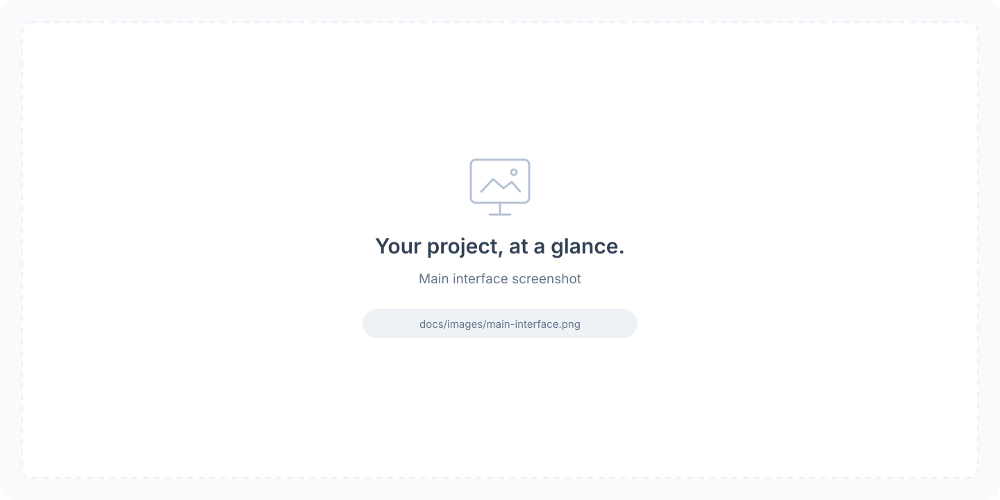

<div align="center">

# AI Helpdesk

**用业务知识回答客户问题，让每次分流与转人工都有据可查。**

多 Agent 智能客服服务，支持混合检索、专家协作、会话记忆与流式回答校验，配套对话、知识库、监控和评测控制台。

[](backend/requirements.txt)
[](backend/app/api/main.py)
[](frontend/package.json)
[](https://github.com/heyemlee/ai-helpdesk/actions/workflows/ci.yml)

[English](README.md) · **简体中文**

[快速开始](#快速开始) · [系统架构](#系统架构) · [技术栈](#技术栈) · [关键设计](#关键设计) · [评测](#评测与当前边界)

</div>

## 项目预览

<!-- 截图准备好后：保存为 docs/images/main-interface.png，并在中英文 README 中替换下方 src。 -->
<p align="center">
  
</p>

> 例如：**“柜门关不严，该怎么处理？”** → 识别安装问题 → 检索排障知识与专家 SOP → 校验回答 → 返回处理建议，或创建人工工单。

- **连续追问**：结合近期对话、历史摘要和用户画像理解上下文；问题不清楚时先澄清。
- **专家协作**：分流到产品与安装、报价与账款、订单履约专家；跨域问题可协作处理，通用 Agent 负责兜底。
- **受控回答**：逐句检查没有依据的价格与时效承诺；意图、路由、Agent 输出分别设置置信度门槛。
- **过程可查**：控制台展示路由依据、知识使用情况、策略违规与转人工状态；请求关联审计、工单和追踪信息。

内置业务场景为橱柜定制与履约。知识库和 SOP 可替换业务内容；如果更换意图分类或专家职责，还需同步调整识别与路由逻辑。

## 系统架构


使用 [Archify](https://github.com/tt-a1i/archify) 生成 · [交互版 HTML](docs/diagrams/architecture.html)（下载后用浏览器打开）· [可编辑 JSON](docs/diagrams/architecture.archify.json)

图中展示同一个 FastAPI 服务内的逻辑模块。PostgreSQL + pgvector 保存知识、长期记忆、画像、工单与审计，Redis 保存工作记忆和共享运行状态。本地持久化可回退 SQLite，Redis 仍需运行。

一次请求经过 **身份校验 → 读取记忆 → 意图识别 → 检索 / 按需查数 → 专家执行 → 回答守卫 → 置信度闸门 → 回复或转人工**。规则锚点命中时跳过意图模型调用及检索改写、重排；复杂问题走完整检索链路，实时订单、库存和回款数据可由独立的 [ai-sql-agent](https://github.com/heyemlee/ai-sql-agent) 服务提供。

## 技术栈

| 层次 | 技术 | 在项目中的作用 |
| --- | --- | --- |
| 运行时与 API | Python 3.12 · FastAPI · Uvicorn · Pydantic 2 | 类型化请求响应、异步接口、启动配置校验 |
| Web Console | React 18 · TypeScript 5 · Vite 6 · Tailwind CSS 4 · TanStack Query 5 | 对话、路由检查、知识库、监控与评测，支持 Markdown 回复 |
| 模型接入 | Anthropic SDK · OpenAI SDK · HTTPX | 可配置服务商，支撑意图、改写、重排、生成与评判 |
| 知识检索 | pgvector · tsvector · Python BM25 · RRF | 语义与关键词召回、排名融合；可选 cross-encoder 精排，回退 LLM 重排 |
| 记忆与存储 | Redis 7 · PostgreSQL 16 · asyncpg · SQLite | 短期状态、长期记忆、画像、工单与审计；本地持久化兜底 |
| 编排与集成 | 自定义 asyncio 编排 · HTTP 工具 · HMAC 令牌 · SSE | 专家协作、下游超时与熔断、用户身份、进度与回答流 |
| 可观测性 | OpenTelemetry · Prometheus · Grafana · Tempo · Loki | 关联指标、日志与追踪；Compose 当前通过 Promtail 采集日志 |
| 工程与交付 | pytest · Ruff · Vitest · Testing Library · GitHub Actions · Docker Compose · Nginx | 后端、前端、契约与镜像检查，11 服务部署编排 |

锁定版本见 [requirements.txt](backend/requirements.txt)、[package-lock.json](frontend/package-lock.json) 与 [Compose](docker-compose.yml)。真实对话需要接入模型；Embedding 和 Rerank 独立配置，未配置远端 Embedding 时使用本地字符 n-gram 向量。

## 关键设计

| 工程问题 | 实现方式 | 源码入口 |
| --- | --- | --- |
| 简单问题也走完整推理，增加等待和成本 | 19 类意图融合 LLM / 向量 / 规则信号（70% / 20% / 10%）；确定性锚点命中后跳过意图推理及检索改写、重排 | [意图识别](backend/app/core/intent_recognizer.py) · [请求准备](backend/app/api/main.py) |
| 语义相近，却漏掉精确业务词 | 稠密与关键词双路并行召回；用 RRF 融合**名次**，避免直接相加量纲不同的相似度和 BM25 分数；中文按字符二元组索引，切片按内容哈希去重 | [知识检索](backend/app/tools/knowledge_base.py) · [关键词索引](backend/app/core/lexical.py) |
| 找到了相关片段，但仍答不了问题 | 改写为三个子查询，合并候选并重排；复用 LLM 重排的充分性判断或分数阈值，围绕缺口最多补检**一轮** | [检索回路](backend/app/tools/tool_manager.py) · [重排](backend/app/core/reranker.py) |
| 问题跨领域，或某个专家实例状态变差 | 综合意图、实体和领域词打分，达标专家并行执行；失败时兜底，Monitor 惩罚分影响同类实例的流量分配 | [编排器](backend/app/agents/agent_orchestrator.py) · [运行反馈](backend/app/monitor/performance_monitor.py) |
| 只靠 Prompt，仍可能承诺没有依据的价格和交期 | 按领域注入可热加载 SOP；生成后依据证据检查价格/时效、改写无依据承诺并记录违规。SSE 缓冲完整句子后经过同一守卫 | [回答策略](backend/app/core/answer_policy.py) · [SOP 加载](backend/app/core/skill_loader.py) |
| 已说“转人工”，但工单或通知没有跟上 | 持久化人工工单；通知发送前先写 Outbox，检查 HTTP 状态，记录重试与最终失败 | [工单](backend/app/tickets/ticket_store.py) · [通知投递](backend/app/tickets/notifier.py) |
| 修改模型或策略后，质量变化难定位 | 返回结构化路由与策略信息，用请求标识关联审计和遥测；带知识上下文的评测结果与显式提升的基线对照 | [API](backend/app/api/main.py) · [评测器](backend/app/evaluation/evaluator.py) |

当前转人工门槛为 **意图置信度 < 0.45、路由分 < 0.35，或 Agent 置信度 < 0.70**。这些是启发式信号，不是经过校准的正确率。回答守卫主要约束价格与时效承诺，不能验证全部事实。

## 快速开始

需要 **Docker、Docker Compose 和模型凭证**。在全新目录中运行：

```bash
git clone https://github.com/heyemlee/ai-helpdesk.git
cd ai-helpdesk
cp .env.example .env
cp backend/.env.example backend/.env
```

编辑 `backend/.env`，配置本机演示环境；已有环境文件时直接编辑，避免覆盖：

```dotenv
APP_ENV=development
LLM_PROVIDER=anthropic
ANTHROPIC_API_KEY=your-api-key
# ANTHROPIC_BASE_URL=https://your-compatible-endpoint
# ANTHROPIC_MODEL=your-model-name
```

示例文件默认是生产模式，需要满足下文的安全配置。完成本机演示配置后启动：

```bash
docker compose up -d --build
```

打开 [http://localhost:5174](http://localhost:5174) 使用客服控制台，或直接请求 API：

```bash
curl -X POST http://localhost:8080/chat \
  -H 'Content-Type: application/json' \
  -d '{"user_id":"demo","message":"柜门关不严，该怎么处理？"}'
```

响应包含 `response`、`intent`、`primary_agent`、`supporting_agents`、`routing_reason`、`answer_confidence`、`policy_violations`、`handoff` 和 `ticket_id`。追问时传入返回的 `conv_id`。上面的无鉴权示例仅适用于本机演示模式。

API 文档：[localhost:8080/docs](http://localhost:8080/docs) · Grafana：[localhost:3000](http://localhost:3000) · Prometheus：[localhost:9090](http://localhost:9090)。Grafana 与数据库凭据在根目录 `.env` 中配置。

### 选择模型服务

OpenAI 兼容端点使用 `LLM_PROVIDER=openai`、`OPENAI_API_KEY`、`OPENAI_MODEL`，按需填写 `OPENAI_BASE_URL`。`EMBEDDING_*` 和 `RERANK_*` 独立配置检索服务；更换 Embedding 模型时需匹配向量维度并重建已有向量。完整配置见 [backend/.env.example](backend/.env.example)，修改后重启。

### 接入自己的业务知识

在知识库面板上传 `.txt`、`.md` 或 JSON 文档列表，也可调用接口：

```bash
curl -X POST http://localhost:8080/knowledge/upload \
  -F 'file=@backend/data/demo_docs/troubleshooting.md'
```

在 `backend/skills/*/SKILL.md` 中维护各专家的处理规范，修改后调用 `POST /skills/reload`。知识库提供参考资料，SOP 规定处理步骤和升级条件。实时业务数据通过 `SQL_AGENT_URL` 及对应凭据接入 ai-sql-agent，详见 [SOP 编写说明](backend/skills/README.md)与[身份集成要求](docs/integrations/sql-agent-identity-requirements.md)。开启鉴权后，这些接口需要携带相应认证头。

<details>
<summary>本地开发：Python + Node.js</summary>

使用 Python 3.12、Node.js 24 和 Redis。完成上面的环境文件配置后，在仓库根目录执行：

```bash
python3 -m venv backend/.venv
backend/.venv/bin/pip install -r backend/requirements.txt
(cd frontend && npm ci)
docker compose up -d redis
```

将 `backend/.env` 的 `REDIS_URL` 设为 `redis://:<根目录 REDIS_PASSWORD>@127.0.0.1:6379/0`；密码中的特殊字符需 URL 编码。未设置 `POSTGRES_DSN` 时使用 SQLite 持久化，**Redis 仍需运行**。本地评测可设置 `EVAL_BASELINE_PATH=./data/eval/baseline.json`。

```bash
scripts/dev.sh
```

访问 [localhost:5173](http://localhost:5173)。后端默认端口为 `8000`，可通过 `API_PORT` 调整，前端代理随之更新。

按 [a2a-contract](https://github.com/heyemlee/a2a-contract/blob/main/README.zh-CN.md) 的本机接法与 [ai-sql-agent](https://github.com/heyemlee/ai-sql-agent) 一起启动：把 ai-sql-agent 放在同级目录（或设置 `SQL_AGENT_DIR`），然后执行：

```bash
scripts/dev-all.sh
```

脚本先在 `127.0.0.1:8000`（ai-sql-agent 自己的 `AI_SQL_PORT`）启动 ai-sql-agent，等 `/health` 和 Agent Card 就绪后，再带上 `SQL_AGENT_URL=http://127.0.0.1:8000` 运行 `scripts/dev.sh`。`API_PORT` 需要换到别的端口（例如 `8080`），两边配成同一个端口时脚本会拒绝启动。Ctrl-C 一次停掉三个进程；再次运行会先停掉上一轮。

</details>

## 评测与当前边界

以下为 **2026-09-22 检索冒烟实测**：8 条内置中文问题、6 个知识片段、SQLite、256 维确定性字符 n-gram 向量，未调用远端 Embedding 或生成模型。

| 检索策略 | MRR | hit@3 |
| --- | --- | --- |
| 纯向量 | 0.583 | 6/8 |
| 纯关键词 | **0.844** | 7/8 |
| RRF 混合检索 | 0.812 | **8/8** |

这组用例中，混合检索让所有目标文档进入前三；纯关键词的 MRR 更高。这是小规模的检索排名验证，不能代表回答准确率、远端 Embedding 效果或生产性能。条件、逐条排名与复现命令见[测量记录](docs/evaluation/retrieval-smoke.md)。

```bash
# 仓库根目录执行；先安装项目依赖，Ruff 需单独安装
backend/.venv/bin/pip install ruff
(cd backend && .venv/bin/python -m pytest && .venv/bin/ruff check .)
(cd frontend && npm test && npm run typecheck && npm run build)
```

[CI](.github/workflows/ci.yml) 覆盖真实 pgvector 服务上的后端测试、前端测试与构建、固定版本的跨仓库 A2A fixtures 和 Docker 镜像。部分本地集成用例需要外部服务或契约仓库。`POST /eval/run` 通过 LLM-as-Judge 评估相关性、准确性、完整性和有用性，`POST /eval/promote` 显式更新对照基线。

压测使用 `backend/scripts/load_test.py --unique-messages --requests 100 --concurrency 10`。保留 `--unique-messages`，避免重复问题命中意图缓存，导致延迟偏低。以上检查尚不能证明真实生产容量或 SLA。

**部署范围**：当前为单租户系统。签名身份用于隔离用户记忆，下游业务数据仍由共享服务密钥决定可见范围，尚未实现按客户的行级授权；开启 impersonation 或声明 `multi_tenant` 都不会补齐这一能力。生产启动要求管理密钥、用户签名密钥、对话鉴权、令牌签发来源白名单和明确的部署范围，详见[部署与安全边界](docs/deployment-boundaries.zh-CN.md)。

<details>
<summary><strong>接口一览</strong></summary>

| 接口 | 用途 |
| --- | --- |
| `POST /chat` · `POST /chat/stream` | 回答、路由依据、策略违规与转人工状态；SSE 支持准备阶段的进度事件 |
| `GET /tickets` · `POST /tickets/{ticket_id}/status` | 查看与推进人工工单 |
| `POST /knowledge/add` · `POST /knowledge/upload` | 导入知识，相同切片去重 |
| `GET /skills` · `POST /skills/reload` | 检查与热加载业务 SOP |
| `POST /eval/run` · `POST /eval/promote` | 运行评测、显式提升基线 |
| `GET /health` · `GET /monitor` · `GET /metrics` | 健康检查、Agent/工具监控与 Prometheus 指标 |
| `POST /auth/token` | 通过可信集成签发用户身份令牌 |

开启保护时，管理接口使用 `X-API-Key`，用户身份通过 `X-User-Token` 传递。`/auth/token` 是可信基础设施接口，不是终端用户登录系统，详见[登录集成说明](docs/auth-token-integration.md)。

</details>

<details>
<summary><strong>项目结构</strong></summary>

```text
backend/app/
  api/ · core/             HTTP/SSE、意图、身份、策略与模型适配
  agents/ · tools/         专家路由、RAG、业务查询与工具治理
  memory/ · storage/       工作/长期记忆、持久化与对话审计
  tickets/                 人工工单与通知 Outbox
  monitor/ · evaluation/   运行反馈与质量回归
backend/skills/            按领域分隔、可热加载的业务 SOP
backend/tests/ · scripts/  测试、检索评测与压测
frontend/src/             React 控制台与路由检查面板
deploy/                   Nginx、指标、日志与追踪配置
scripts/                  本地启动、部署、备份恢复与本地 CI
docs/                     架构、集成、测量与运维记录
```

</details>

## 深入阅读

[架构详解](docs/architecture.md) · [代码导览](docs/code-guide.md) · [后端说明](backend/README.md) · [SOP 编写](backend/skills/README.md) · [登录集成](docs/auth-token-integration.md) · [部署边界](docs/deployment-boundaries.zh-CN.md) · [架构图维护](docs/diagrams/README.md)
