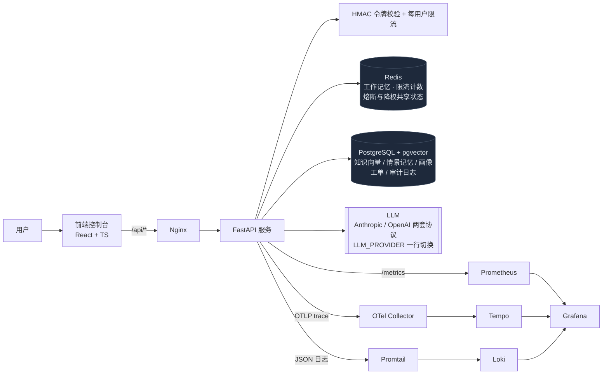
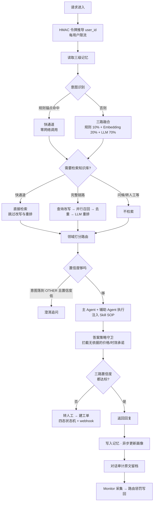
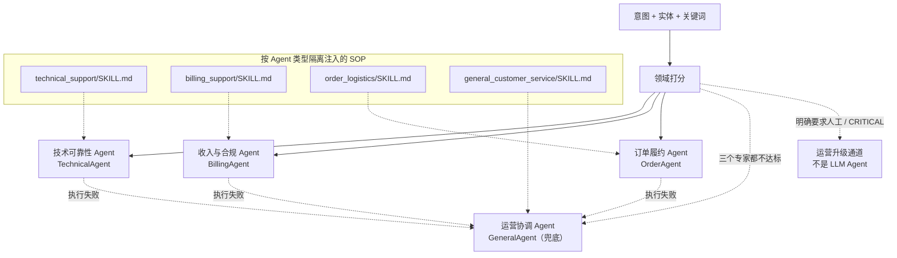
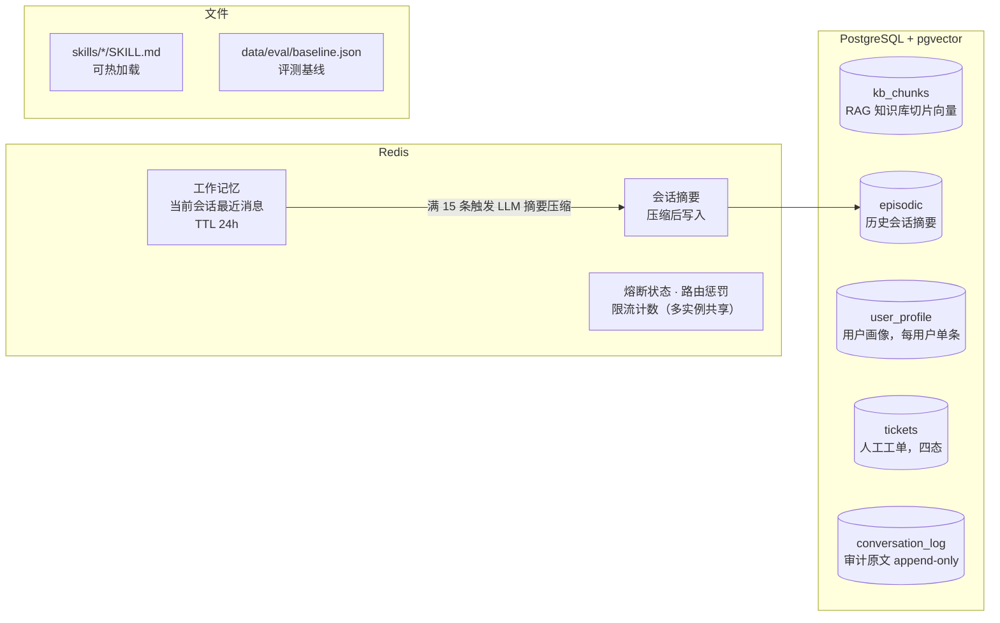
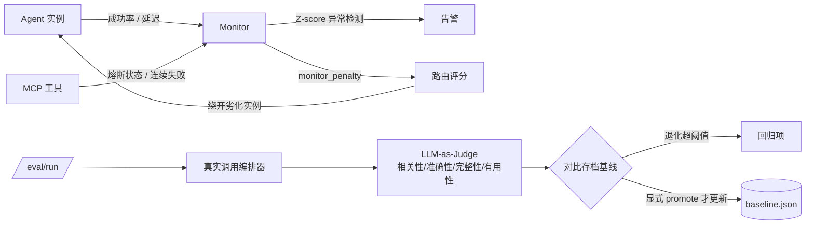
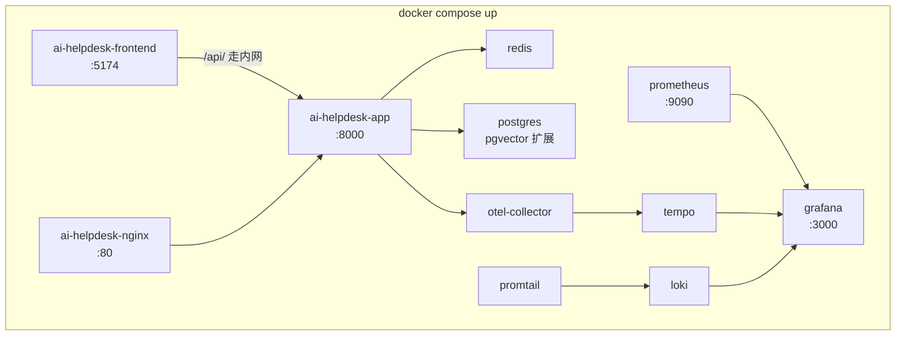

# 架构图

用 Mermaid 而不是导出的 SVG：GitHub 原生渲染，改代码时能顺手改图，
不会出现"图里画着三个 Agent、文字写着四个"这种图文不一致。

## 1. 总体架构

对外接口：`/chat`、`/chat/stream`、`/auth/token`、`/search`、`/skills`、
`/knowledge/*`、`/tickets`、`/eval/run`、`/eval/promote`、`/monitor`、`/metrics`。

## 2. `/chat` 主链路

## 3. Agent 阵容与路由

要点：

- **三个专家按领域分竞争主 Agent**，General 只拿固定基准分，不参与专家域竞争。
- 跨域工单里达到门槛的其他专家升为**辅助 Agent**，与主 Agent 并行执行后合并结果。
- 每种类型可起多个实例；Monitor 观测到某实例劣化后，流量自动倒向同类型的健康实例。
- Skill 按 `agents` 和 `keywords` 匹配，避免不同领域的规则互相污染。

## 4. 数据与存储

## 5. 监控与评测闭环

**基线只在显式 `/eval/promote` 时更新**——每跑完一次就覆盖的话，
"相比基线退化"永远为空。

## 6. 部署结构

共 11 个服务。观测栈（Collector / Tempo / Loki / Promtail / Grafana）与业务无耦合，
不需要时删掉对应 service 即可，应用侧只是少了 trace 上报目标。

挂载 `./backend/skills`（热加载 SOP）、`./backend/data/eval`（评测基线）、
`./backend/logs`（供 Promtail 采集）。

前端容器的 Nginx 用变量 + `resolver` **在请求时**解析后端地址而不是启动时：
否则后端还没就绪，前端容器会直接 `[emerg] host not found` 起不来，
后端重启换 IP 后又会一直打到旧地址。
