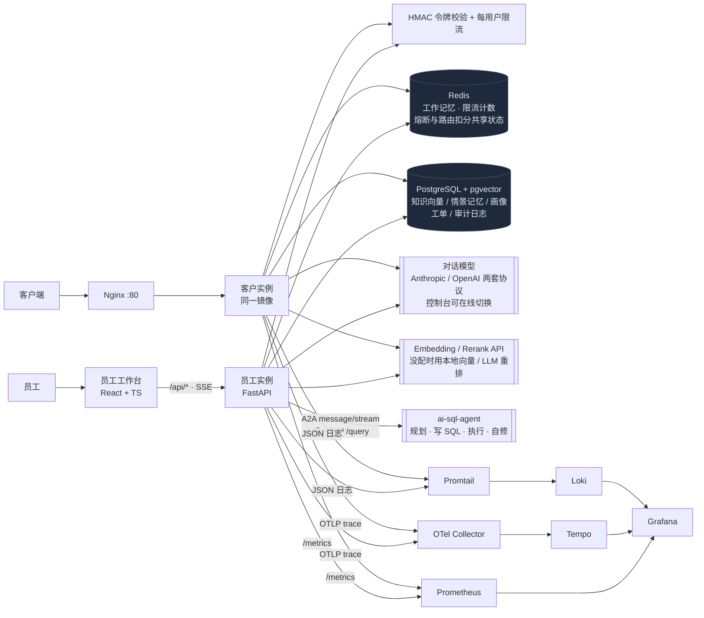
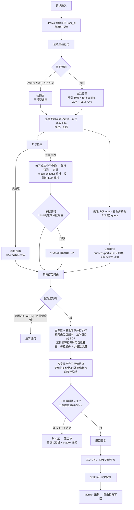
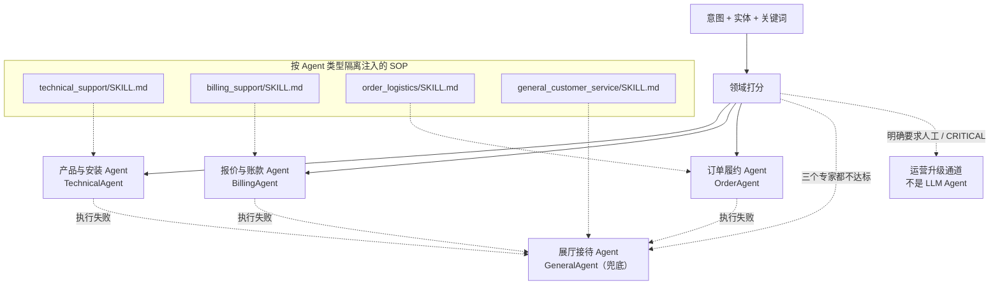
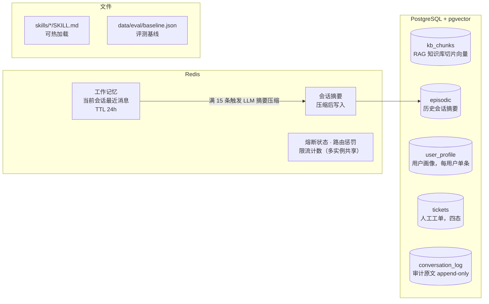
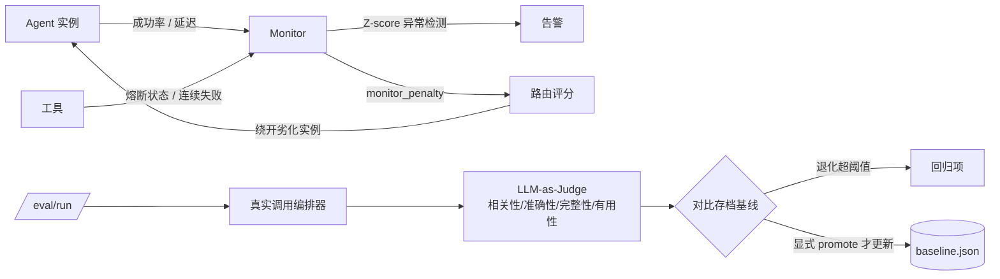
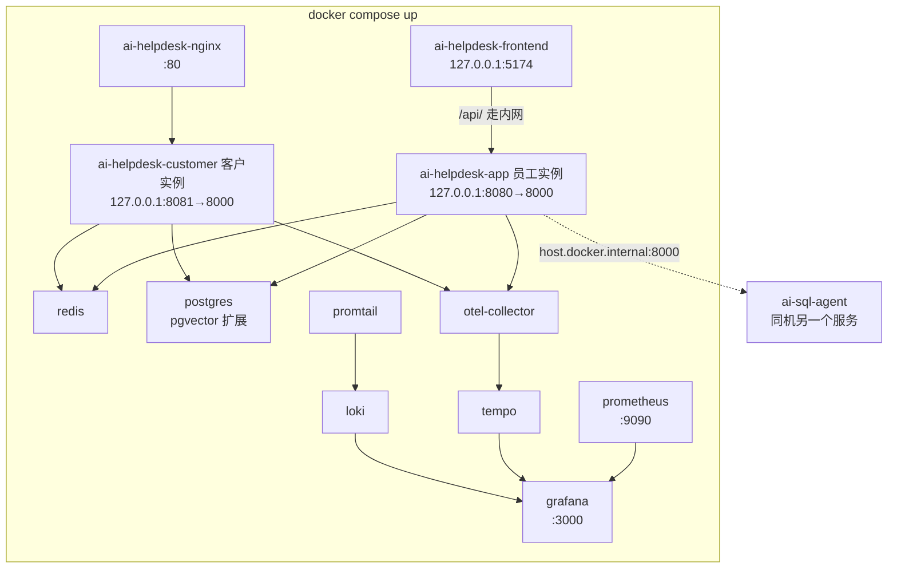

# 架构图

README 使用手写的动态图 [architecture.svg](architecture.svg)；[Archify 总览图](diagrams/README.md) 保留可编辑 JSON、交互 HTML 和静态 SVG。
本页以 GitHub 原生支持的 Mermaid 补充请求链路、路由、存储与部署细节；修改架构时需同步更新两处。

## 1. 总体架构

客户实例和员工实例是同一个镜像，区别有两处：不委派 SQL Agent（`SQL_AGENT_URL` 留空），关掉跨会话记忆（它的 user_id 取自请求体）。委派走哪条传输由 `SQL_AGENT_TRANSPORT` 决定：`a2a` 走 `message/stream`，把下游每个阶段实时转给工作台；默认的 `query` 调同步的 `POST /query`，没有进度事件。

对外接口：`/chat`、`/chat/stream`、`/auth/token`、`/search`、`/skills`、`/sops`、
`/knowledge/*`、`/tickets`、`/conversations/{conv_id}`、`/eval/run`、`/eval/promote`、`/admin/model*`、`/health`、`/monitor`、`/metrics`。

## 2. `/chat` 主链路

知识检索和委派查库在专家运行之前就并发跑完，查不查由规则决定。工具循环（`AI_HELPDESK_TOOL_LOOP`，默认关）打开后，专家读完这些资料还缺东西时，可以通过 function calling 自己再调同样的两个工具：每个专家每轮最多 3 次模型调用、1 次由模型发起的委派，模型只填查询词、身份由服务端注入，报价意图不许查库，和预取相同的查询直接复用，墙钟上限按最慢工具的超时推算，规则预取那次委派已经超时就不再委派；工具的任何失败都作为结果交还模型。关着时每一轮的模型调用次数可预期。开放式的循环（规划 SQL、出错自修）在 SQL Agent 里，由钉住版本的契约约束。模型服务不可用时这一轮返回"没有作答"，不建工单。

轨迹 A/B（[评测记录](evaluation/tool-loop-ab.md)）第二轮 10 道打开门槛全过：规则漏掉数据的 B 类问题从 0/30 轮拿到数据变成 26/30，没有越权调用、没有编造数字，所以员工实例上打开了循环，客户实例保持关闭。

## 3. Agent 阵容与路由

要点：

- **三个专家按领域分竞争主 Agent**，General 只拿固定基准分，不参与专家域竞争。
- 跨域问题里分数不低于 0.45、且不低于主专家 55% 的其他专家升为**辅助 Agent**，与主 Agent 并行执行后合并结果。并行的结果一次性返回，单个专家的回答才逐句流式输出。
- 每种类型默认起两个实例（`AI_HELPDESK_AGENT_REPLICAS`）。路由分 = (成功率 × 0.7 + 延迟分 × 0.3) × (1 − 监控扣分)；成功率低于 90% 或变慢时 Monitor 扣分，最多 0.9，流量自动倒向同类型的健康实例，同分时轮询。
- 专家在回答末尾用 `[[handoff:yes|no]]` 声明要不要人工，这个标记在流里就被摘掉；声明要人工时自评置信度降到 0.65，低于 0.70 的门槛。标记缺失时退回关键词判断。
- 流式输出到一半失败时不降级重跑（已经发出去的内容收不回来），如实报告没有答完。
- Skill 按 `agents` 和 `keywords` 匹配，避免不同领域的规则互相污染。

## 4. 数据与存储

## 5. 监控与评测闭环

**基线只在显式 `/eval/promote` 时更新**——每跑完一次就覆盖的话，
"相比基线退化"永远为空。

**工具循环另有一套轨迹评测**（`scripts/run_trajectory_eval.py`）：40 条用例，每条只做一次准备阶段，
规则组和循环组从同一个请求分别作答，订单数据走读 a2a-contract 夹具的桩。打分是确定性规则
（资料到没到手、该调的调了没有、参数对不对、多余调用、编造数字），可选再加 LLM 评审，
按 6 道门槛决定开不开。线上由 Prometheus 的 `agent_loop_*` 指标看每轮的模型调用次数、
每个工具的结局、被要求直接作答和退回单次生成的次数。

## 6. 部署结构

共 12 个服务。只有 Nginx 的 80 端口对外，其余端口只绑本机：员工实例和工作台背后没有 API key，不能直接开放给其他机器。两个实例共用 Redis 和 PostgreSQL，并挂同一个模型设置目录：员工工作台保存模型连接后，客户实例几秒内跟上。观测栈（Collector / Tempo / Loki / Promtail / Grafana）与业务无耦合，不需要时删掉对应 service 即可，应用侧只是少了 trace 上报目标。

挂载 `./backend/skills`（热加载 SOP）、`./backend/data/eval`（评测基线）、`./backend/data/runtime`（模型设置）、
`./backend/logs`（供 Promtail 采集）。

前端容器的 Nginx 用变量 + `resolver` **在请求时**解析后端地址而不是启动时：
否则后端还没就绪，前端容器会直接 `[emerg] host not found` 起不来，
后端重启换 IP 后又会一直打到旧地址。
